# TÀI LIỆU PHÂN TÍCH NGHIỆP VỤ & THIẾT KẾ KỸ THUẬT
## Module Quản lý Test Case (Test Case Management – TCM)
### ABP Framework 10.6 · .NET 10 · Angular 22 · Reusable Module `Acme.TestCaseManagement`

| Mục | Nội dung |
| :--- | :--- |
| Mục đích | Trình bày nghiệp vụ, quy tắc, mô hình dữ liệu và thiết kế kỹ thuật của module để duyệt trước khi tích hợp vào hệ thống ABP của công ty |
| Đối tượng đọc | Trưởng nhóm / quản lý kỹ thuật, QA Lead, lập trình viên tích hợp |
| Tài liệu liên quan | `specs/001-test-case-management/{spec,plan,tasks}.md`, `Acme.TestCaseManagement/README.md`, `docs/HUONG_DAN_SU_DUNG.md` |
| Ghi chú | Tài liệu mô tả **hệ thống như đã xây dựng**. Những gì nằm ngoài phạm vi hiện tại được nêu riêng ở mục 12 |
| Tác giả | (điền tên người chịu trách nhiệm tài liệu) |

**Lịch sử phiên bản tài liệu**

| Phiên bản | Ngày | Nội dung |
| :--- | :--- | :--- |
| 1.0 | 2026-10-12 | Bản đầu đủ nghiệp vụ và sơ đồ, đối chiếu với code |
| 1.6 | 2026-10-13 | Mã test case tự sinh theo dự án (BR-TC-12), nhân bản test case (UC-33, BR-TC-13), kết quả chạy theo từng bước (UC-34, BR-RUN-11 đến 13; bảng `TcmTestStepResults`); bỏ ba mục này khỏi phần chưa làm |
| 1.5 | 2026-10-13 | Xuất biên bản nghiệm thu ra PDF và Excel (UC-32, BR-RPT-01 đến 04, API `sign-off/{id}/export`); bỏ mục này khỏi phần chưa làm |
| 1.4 | 2026-10-13 | Duyệt hàng loạt test case; thành viên theo dự án (dự án có thể chỉ cho thành viên xem); test case giữ mã dự án; cập nhật quy tắc, use case, tích hợp và các mục giới hạn |
| 1.3 | 2026-10-13 | Ghi các quyết định nghiệp vụ đã xác nhận (mục 12.4); chạy lại MySQL 8.4.11; bỏ trường người phụ trách cấp run khỏi mô tả thực thể |
| 1.2 | 2026-10-12 | Thêm so sánh hai phiên bản, lịch sử thay đổi của từng test case (bảng `TcmTestCaseHistory`), xóa run chưa có kết quả; bỏ ba hạng mục này khỏi phần chưa làm |
| 1.1 | 2026-10-12 | Sau review: phiên bản test case chụp thêm Priority, Severity, Kind, Layer, ExecutionType; Quality Gate đọc priority từ phiên bản đã chạy; test case chờ duyệt lại vẫn đưa vào run được; bổ sung quy tắc Superseded, mã băm, phạm vi nghiệm thu, flaky, mục 13 chuyển đổi và triển khai |

---

## MỤC LỤC
1. Tổng quan và phạm vi
2. Tác nhân và phân quyền
3. Kiến trúc tổng thể
4. Mô hình nghiệp vụ và dữ liệu
5. Quy trình nghiệp vụ
6. Danh mục Use Case
7. Quy tắc nghiệp vụ
8. Báo cáo và chỉ số
9. Yêu cầu phi chức năng
10. Tích hợp vào ứng dụng ABP của công ty
11. Kiểm thử và chất lượng
12. Giới hạn, ngoài phạm vi và hướng phát triển
13. Chuyển đổi dữ liệu và triển khai (đề xuất)
- Phụ lục A: Thuật ngữ · Phụ lục B: Danh sách API · Phụ lục C: Mã lỗi nghiệp vụ

---

## 1. TỔNG QUAN VÀ PHẠM VI

### 1.1. Bối cảnh và vấn đề
Đội QA quản lý test bằng Excel / Google Sheets gặp các vấn đề lặp lại:

| Vấn đề | Hậu quả |
| :--- | :--- |
| Mỗi đợt release nhân bản một sheet | Kịch bản gốc đổi thì sheet cũ không theo; sheet mới mất lịch sử |
| Sửa trạng thái Fail thành Pass khi retest | Mất bằng chứng lần Fail đầu, không đo được tỷ lệ lỗi tái hiện |
| Kịch bản sửa giữa chừng | Các đợt test cũ đổi nội dung theo, biên bản nghiệm thu sai so với dữ liệu lúc chạy |
| Không có số liệu tổng hợp | PM / PO không biết đã chạy bao nhiêu, nghẽn ở đâu |
| Nhiều dự án dùng chung một nơi | Test, kế hoạch, yêu cầu của các dự án lẫn vào nhau |

### 1.2. Mục tiêu
1. Một **thư viện test case dùng lâu dài**, tách khỏi từng đợt chạy.
2. **Phiên bản bất biến**: kết quả chạy luôn trỏ về đúng nội dung đã chạy.
3. **Lịch sử chạy không ghi đè**: nhiều lần chạy cho cùng một test, giữ nguyên lần Fail.
4. **Truy vết yêu cầu** và **cổng chất lượng** trước khi nghiệm thu.
5. **Tách theo dự án** để nhiều dự án dùng chung hệ thống mà không lẫn dữ liệu.
6. **Đóng gói như module ABP** để cắm vào ứng dụng ABP của công ty (đăng nhập, quyền, audit, đa tenant dùng chung).

### 1.3. Vì sao tự xây trên ABP
| Lý do | Giải thích |
| :--- | :--- |
| Dữ liệu nội bộ | Kịch bản và lỗi không rời khỏi hệ thống của công ty |
| Không phí bản quyền theo người dùng | So với dịch vụ SaaS tính theo từng người dùng |
| Dùng chung hạ tầng ABP | Đăng nhập, phân quyền, audit, đa tenant có sẵn |
| Tùy biến | Có thể mở rộng theo quy trình nội bộ |

### 1.4. Phạm vi chức năng

**Trong phạm vi (đã xây dựng):**

| Nhóm | Chức năng |
| :--- | :--- |
| Dự án | Tạo, sửa, lưu trữ, xóa khi trống; dự án mặc định; chọn dự án đang làm việc; dự án chỉ cho thành viên xem |
| Thư viện test | Cây suite lồng nhau, test case có bước, tag, bộ lọc; vòng duyệt; phiên bản bất biến và so sánh hai phiên bản; lịch sử thay đổi từng test case; duyệt hàng loạt; nhóm bước dùng chung; mã test case tự sinh theo dự án; nhân bản test case |
| Kế hoạch và thực thi | Test plan; test run (trong hoặc ngoài plan); run item gắn đúng phiên bản; gán người test; ghi kết quả đơn lẻ hoặc hàng loạt; nhiều lần chạy; kết quả theo từng bước; xóa run chưa có kết quả |
| Truy vết | Requirement; ma trận truy vết RTM |
| Chất lượng | Quality Gate cấu hình được; nghiệm thu (Sign-off) nhiều người ký có băng SHA-256 |
| Báo cáo | Dashboard (pass rate, tốc độ, burn-down, mật độ lỗi); phát hiện test chập chờn (flaky) |
| Nhập / xuất | Test case và kết quả chạy ra Excel / CSV; nhập có chạy thử, tất cả hoặc không gì; biên bản nghiệm thu ra PDF (để in và ký) hoặc Excel |
| Đính kèm | Ảnh, log, video cho test case và cho từng lần chạy |
| AI | Gợi ý bước kiểm thử từ nội dung yêu cầu, người dùng duyệt trước khi thêm |
| Giao diện | Thư viện trang Angular 22, tiếng Anh và tiếng Việt |

**Ngoài phạm vi hiện tại:** xem mục 12.

### 1.5. Nguyên tắc thiết kế cốt lõi
- **Tách thư viện và thực thi.** Cây thư viện là tài sản tri thức dùng lại qua nhiều Sprint nên **không chứa** Sprint hay Milestone. Plan và Run mới là ngữ cảnh thực thi (môi trường, thời gian).
- **Bất biến.** Phiên bản test case không sửa được; lần chạy (attempt) không sửa, không xóa.
- **Không phụ thuộc host.** Module không khóa ngoại tới bảng người dùng của host; chỉ dùng trừu tượng của ABP (người dùng hiện tại, tenant, audit, phân quyền).
- **Tương thích ngược.** Dữ liệu tạo ra khi chưa chọn dự án rơi vào dự án mặc định nên client cũ vẫn chạy.

---

## 2. TÁC NHÂN VÀ PHÂN QUYỀN

### 2.1. Tác nhân

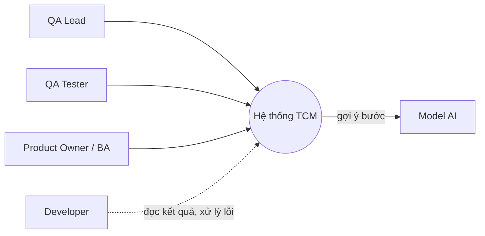

### 2.2. Ma trận trách nhiệm RACI

```
R: Responsible (thực hiện) | A: Accountable (chịu trách nhiệm chính)
C: Consulted (tham vấn)    | I: Informed (nhận thông tin)
```

| Hoạt động | QA Lead | QA Tester | Developer | PO / BA |
| :--- | :---: | :---: | :---: | :---: |
| Quản lý dự án | A / R | I | I | I |
| Soạn thảo test case | A | R | C | C |
| Duyệt / đưa về nháp / ngừng dùng | A / R | I | I | C |
| Lập plan, tạo run, gán người test | A / R | I | I | I |
| Thực thi run, ghi kết quả | A | R | I | I |
| Quản lý requirement | C | C | I | A / R |
| Cấu hình Quality Gate | A / R | C | I | C |
| Ký nghiệm thu | R | C | I | A / R |

### 2.3. Danh mục quyền (nhóm `TestCaseManagement`)
Quyền `Default` cho phép **đọc**; quyền con cho phép **thay đổi**. Quyền được cấp trong màn hình Roles của host.

| Quyền | Quyền con | Cho phép |
| :--- | :--- | :--- |
| `TestCases` | `Create`, `Update`, `Delete` | Tạo, sửa, xóa test case |
| | `Approve` | Gửi duyệt, duyệt, đưa về nháp, ngừng dùng |
| | `SuggestSteps` | Hỏi AI gợi ý bước (tách riêng vì nội dung rời hệ thống) |
| `Projects` | `Manage` | Tạo, sửa, lưu trữ, xóa dự án; đặt dự án chỉ cho thành viên xem và chọn thành viên. Người có quyền này **thấy mọi dự án**. Người dùng khác thấy các dự án không hạn chế và các dự án mình là thành viên |
| `TestSuites` | `Manage` | Tạo, sửa, di chuyển, xóa suite |
| `TestPlans` | `Manage` | Quản lý plan; tạo run, thêm test, gán người, hoàn tất run |
| `TestRuns` | `Execute` | Ghi kết quả; quản lý liên kết lỗi |
| `Requirements` | `Manage` | Quản lý requirement và liên kết với test case |
| `QualityGates` | `Manage` | Quản lý cổng chất lượng |
| `SignOff` | `Approve` | Bắt đầu và ký nghiệm thu |
| `SharedSteps` | `Manage` | Quản lý nhóm bước dùng chung, cập nhật hàng loạt |

Các quyền ở trên áp dụng **toàn hệ thống** (cấp theo vai trò trong ứng dụng của công ty). Việc **ai thấy dự án nào** do thành viên của dự án quyết định (xem 5.1).

---

## 3. KIẾN TRÚC TỔNG THỂ

### 3.1. Bối cảnh hệ thống

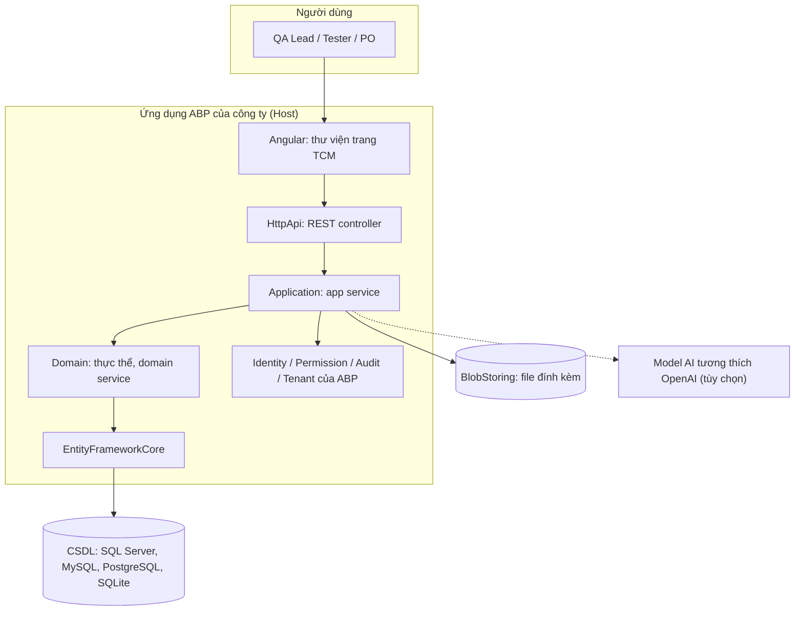

### 3.2. Các tầng và gói

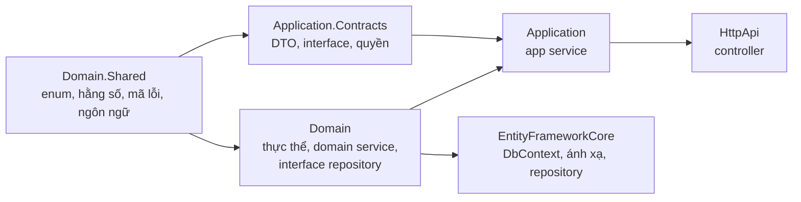

| Gói | Vai trò | Tham chiếu từ |
| :--- | :--- | :--- |
| `Acme.TestCaseManagement.Domain.Shared` | enum, hằng số, mã lỗi, ngôn ngữ en / vi | mọi tầng |
| `…Domain` | aggregate, domain service, interface repository | host (gián tiếp) |
| `…Application.Contracts` | DTO, interface app service, định nghĩa quyền | host và ứng dụng client |
| `…Application` | app service | host |
| `…EntityFrameworkCore` | DbContext, ánh xạ bảng, repository | host |
| `…HttpApi` | REST controller | host |
| `angular/projects/test-case-management` | giao diện Angular (chia sẻ dạng thư mục mã nguồn) | ứng dụng Angular của host |

Ngoài ra có **host mẫu** (`host/Acme.TestCaseManagement.HttpApi.Host`: SQLite, JWT, Swagger) dùng để chạy thử độc lập.

### 3.3. Hai cách đặt cơ sở dữ liệu
| Cách | Mô tả |
| :--- | :--- |
| Dùng `TestCaseManagementDbContext` của module | Đọc chuỗi kết nối `TestCaseManagement`, lùi về `Default`; host chọn nhà cung cấp |
| **Nhúng model vào DbContext của host** (khuyến nghị) | `[ReplaceDbContext(typeof(ITestCaseManagementDbContext))]`, khai báo đủ `DbSet`, gọi `builder.ConfigureTestCaseManagement(this)` (truyền chính DbContext để bộ lọc theo dự án đọc được phạm vi của người gọi) |

Bảng có tiền tố `Tcm` (`TcmTestCases`, `TcmTestRuns`…), đổi được bằng `TestCaseManagementDbProperties`. Module **không kèm migration** vì nhà cung cấp CSDL thuộc về host.

### 3.4. Lớp giao diện Angular
- Shell có thanh chọn dự án ở đầu; mọi trang tải lại khi đổi dự án.
- Trang: Dashboard, Test repository, Plans and runs (chi tiết run), Requirements và RTM, Quality gates, Sign-off, Shared steps, Projects.
- Trang mang style riêng bọc trong `.tcm`, không làm hỏng style của host; menu và quyền tích hợp với host ABP.

---

## 4. MÔ HÌNH NGHIỆP VỤ VÀ DỮ LIỆU

### 4.1. Phân cấp tổng quát

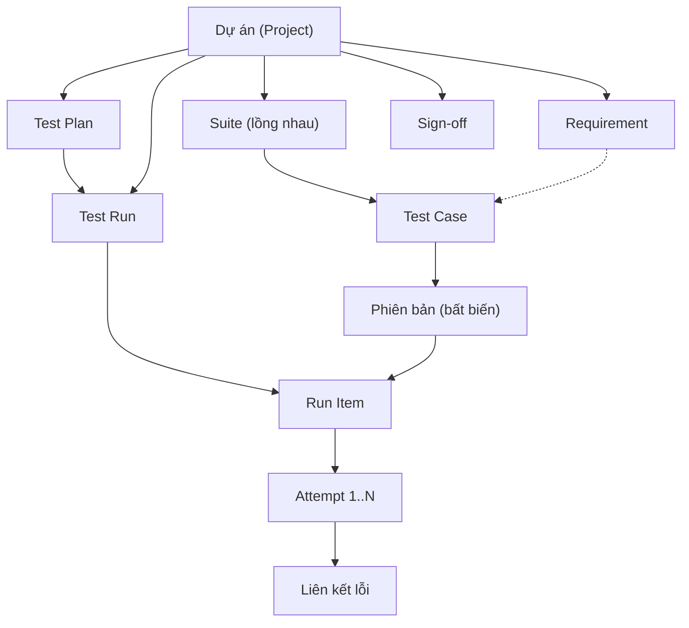

### 4.2. Sơ đồ thực thể (ERD)

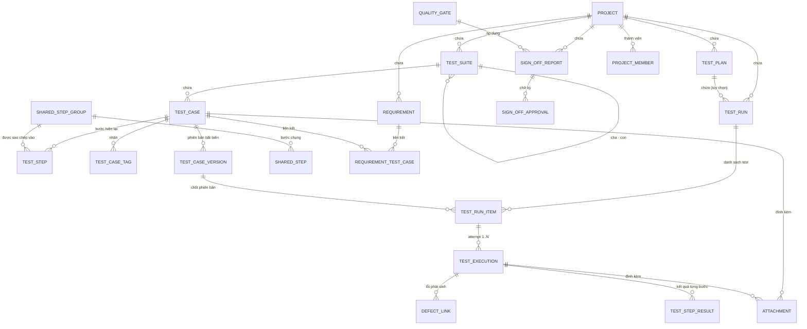

Người dùng được lưu dưới dạng `Guid` (id) và audit của ABP; module **không có khóa ngoại** tới bảng người dùng của host. Mọi thực thể hỗ trợ `TenantId` (đa tenant).

### 4.3. Mô tả thực thể

| Thực thể | Trường chính | Ghi chú |
| :--- | :--- | :--- |
| **Project** (`TcmProjects`) | `Key`, `Name`, `Description`, `IsArchived`, `IsRestricted`, `LastTestCaseNumber` | `Key` 2–10 ký tự chữ hoa / số, bắt đầu bằng chữ, duy nhất, không đổi. `LastTestCaseNumber` là số cuối đã cấp cho mã test case của dự án, chỉ tăng |
| **ProjectMember** (`TcmProjectMembers`) | `ProjectId`, `UserId`, thời điểm và người thêm (audit tạo của ABP) | Người được xem một dự án hạn chế; duy nhất theo (dự án, người); không khóa ngoại tới người dùng |
| **TestSuite** | `ProjectId`, `ParentId?`, `Name`, `Description`, `Order` | Cây không giới hạn cấp |
| **TestCase** | `SuiteId`, `ProjectId`, `Code`, `Title`, `Description`, `Preconditions`, `Postconditions`, `Priority`, `Severity`, `Status`, `ExecutionType`, `Kind`, `Layer`, `IsFlaky`, `CurrentVersion`, `Steps`, `Tags` | Thuộc dự án của suite; `ProjectId` được chép từ suite để lọc theo dự án; `Code` duy nhất toàn thư viện |
| **TestStep** | thứ tự, hành động, dữ liệu test, kết quả mong đợi, liên kết nhóm bước chung | |
| **TestCaseVersion** | `TestCaseId`, `VersionNumber`, `Title`, `Preconditions`, `Postconditions`, `StepsJson`, `ChangeSummary?`, `Priority?`, `Severity?`, `Kind?`, `Layer?`, `ExecutionType?` | Bản chụp bất biến lúc duyệt, gồm cả phân loại của test case. Năm trường phân loại để trống ở phiên bản tạo trước khi có snapshot này; khi đó hệ thống lấy giá trị hiện tại của test case |
| **TestCaseHistoryEntry** (`TcmTestCaseHistory`) | `TestCaseId`, `Type`, `FromValue?`, `ToValue?`, `VersionNumber?`, `Note?`, thời điểm và người ghi (audit tạo của ABP) | Một dòng của lịch sử test case; chỉ thêm, không khóa ngoại tới test case |
| **SharedStepGroup / SharedStep** | tên, các bước, số hiệu chỉnh sửa (revision) | Test case giữ **bản sao riêng** kèm liên kết |
| **TestPlan** | `ProjectId`, `Name`, `Description`, `MilestoneId?`, `StartDate`, `EndDate`, `Status` | |
| **TestRun** | `ProjectId`, `TestPlanId?`, `Title`, `Environment`, `Status` | Có thể đứng ngoài plan. Người thực hiện từng test được gán ở `TestRunItem.AssignedUserId` |
| **TestRunItem** | `TestRunId`, `TestCaseVersionId`, `Sequence`, `AssignedUserId?`, `CurrentStatus` | Bắt buộc gắn phiên bản |
| **TestExecution** | `TestRunItemId`, `AttemptNumber`, `Status`, `ActualResult`, `DurationSeconds` | Chỉ thêm, không sửa |
| **TestStepResult** (`TcmTestStepResults`) | `TestExecutionId`, `StepId`, `StepOrder`, `Status`, `ActualResult?` | Kết quả của một bước trong một lần chạy; `StepId` là mã bước trong phiên bản mà item chạy; chỉ thêm; duy nhất theo (lần chạy, bước); không khóa ngoại tới bước |
| **DefectLink** | `TestExecutionId`, `ExternalSystem`, `IssueKey`, `IssueUrl?`, `Severity`, `IsResolved`, `ResolvedTime?` | Chỉ gắn vào attempt Failed |
| **Requirement** | `ProjectId`, `Code`, `Title`, `Description`, `AcceptanceCriteria`, `Priority`, `MilestoneId?` | `Code` duy nhất toàn thư viện |
| **RequirementTestCase** | `RequirementId`, `TestCaseId` | Liên kết nhiều–nhiều |
| **QualityGate** | `Name`, `Description`, `MinPassRate`, `RequiredApprovals`, `IsDefault` | |
| **SignOffReport / SignOffApproval** | phạm vi (plan hoặc milestone), `ProjectId`, tên và ngưỡng gate đã chụp, `Status`, `SummaryStatsJson`, `SnapshotHash`, người ký | |
| **Attachment** | chủ sở hữu (test case hoặc attempt), tên file, loại, dung lượng | Nội dung lưu trong blob container |

### 4.4. Danh mục giá trị

| Danh mục | Giá trị |
| :--- | :--- |
| `TestCaseStatus` | Draft, UnderReview, Approved, Deprecated |
| `PriorityLevel` | Low, Medium, High, Urgent |
| `SeverityLevel` | Low, Medium, High, Critical |
| `ExecutionType` | Manual, Automated, Hybrid |
| `TestKind` | Functional, Performance, Security, Usability |
| `TestLayer` | Unit, Integration, E2E, Acceptance |
| `PlanStatus` | Draft, Active, Completed, Archived |
| `RunStatus` | Planned, InProgress, Completed |
| `TestResultStatus` | Untested, Passed, Failed, Blocked, Skipped |
| `SignOffStatus` | Pending, Approved, Superseded |
| `RequirementCoverageStatus` | Uncovered, NotRun, Passed, Failed, Blocked |
| `TestCaseHistoryType` | Created, Edited, StatusChanged, VersionPublished, TagsChanged, StepsReordered, SharedStepsChanged |
| `FlakinessLevel` | Insufficient, Stable, Watch, Flaky |

---

## 5. QUY TRÌNH NGHIỆP VỤ

### 5.1. Dự án

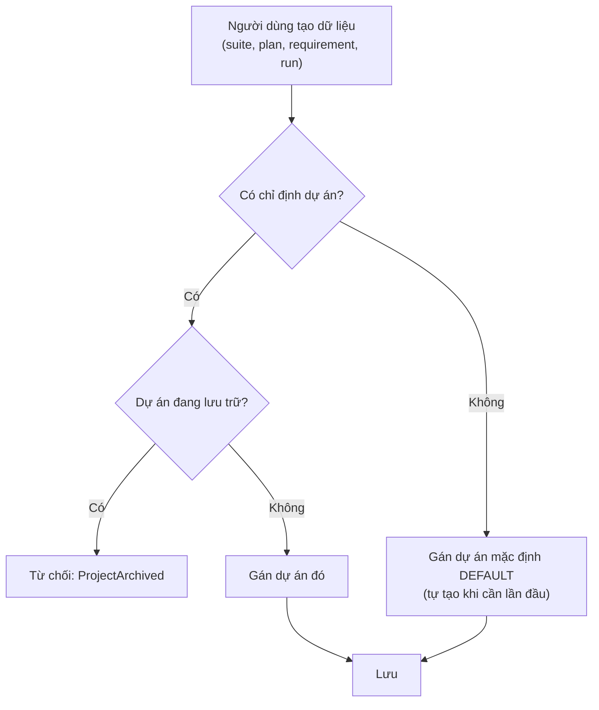

**Mô tả:**
- Dự án là cấp cao nhất. Suite, plan, requirement, run và sign-off thuộc **đúng một** dự án; test case thuộc dự án thông qua suite.
- **Không trộn dự án** (lỗi `DifferentProject`): suite con cùng dự án với cha; không chuyển suite hay test case sang dự án khác; không đưa test case vào run của dự án khác; không liên kết test case với requirement của dự án khác; run của một plan thuộc dự án của plan; run không có plan lấy dự án của test case đầu tiên.
- **Lưu trữ:** dự án lưu trữ vẫn đọc được nhưng không thêm được gì. **Xóa** chỉ khi dự án không còn suite, plan, requirement, run.
- **Dữ liệu cũ:** lần đầu gọi danh sách dự án trên thư viện chưa có dự án, hệ thống tạo `DEFAULT` và gán toàn bộ dữ liệu cũ vào (một lần).
- **Dùng chung có chủ đích:** nhóm bước dùng chung, mã test case và mã requirement (nên đặt tiền tố như `EINV-`), Quality Gate, phân quyền.
- **Thành viên và quyền xem:** mỗi dự án có cờ **"chỉ thành viên"**. Tắt (mặc định, và là trạng thái của mọi dự án có từ trước): ai được dùng module cũng thấy dự án. Bật: chỉ **thành viên** của dự án và những người có quyền `Projects.Manage` thấy dự án **và mọi thứ trong đó** (suite, test case, plan, run, requirement, nghiệm thu, tệp đính kèm, lỗi liên kết). Với người ngoài, dữ liệu đó **không tồn tại**: không có trong danh sách, dashboard, ma trận truy vết, xuất dữ liệu, và gọi theo id thì "không tìm thấy". Danh sách thành viên giữ nguyên khi tắt cờ nhưng không có tác dụng. Thành viên vẫn bị giới hạn bởi quyền theo vai trò (ví dụ chỉ đọc thì không sửa được). Người gọi không phải người dùng (API key) không bị giới hạn.
- Giao diện: thanh chọn dự án ở đầu trang (nhớ lựa chọn lần sau), mọi danh sách, dashboard, RTM, xuất dữ liệu theo dự án đang chọn; dự án `DEFAULT` hiển thị chỉ tên.

### 5.2. Vòng đời test case và phiên bản

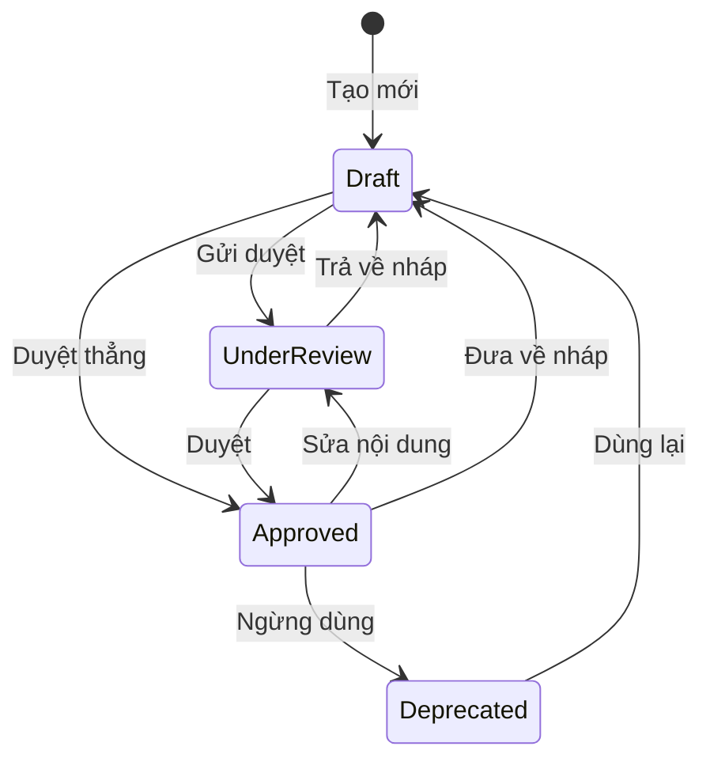

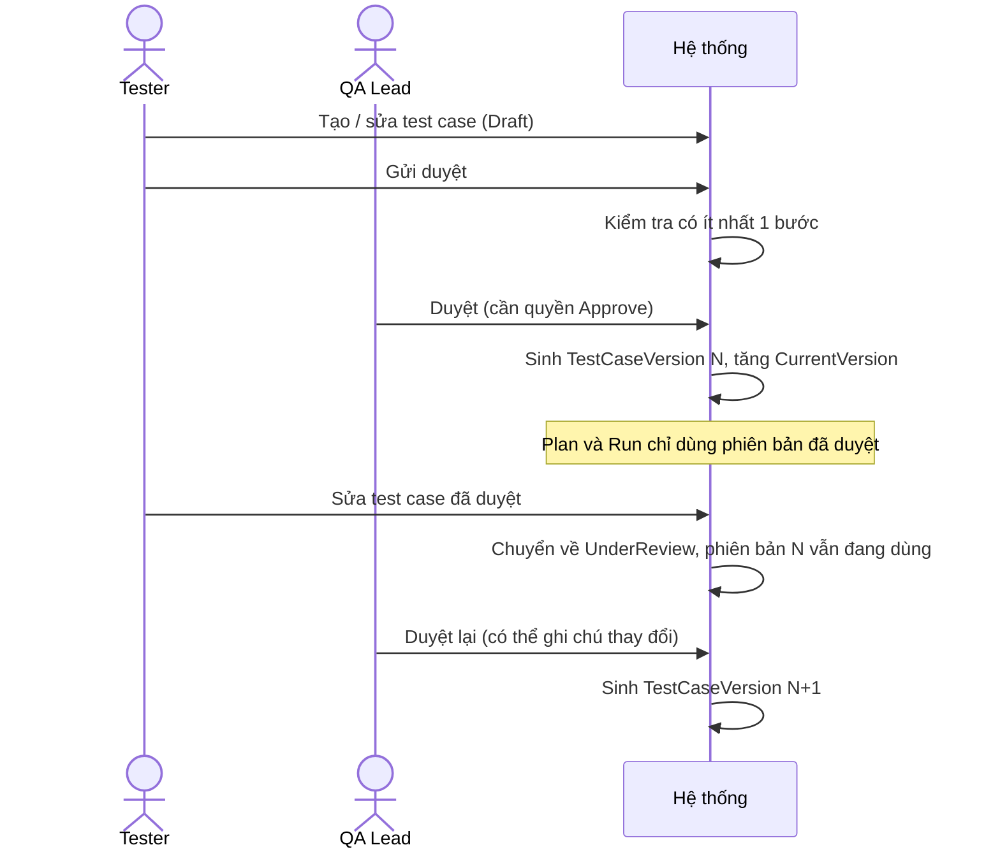

**Mô tả:**
1. **Soạn mới:** trạng thái Draft. Cần ít nhất 1 bước trước khi gửi duyệt hoặc duyệt.
2. **Duyệt:** người có quyền `Approve`; hệ thống sinh `TestCaseVersion` bất biến chứa tiêu đề, tiền / hậu điều kiện, toàn bộ bước (`StepsJson`) **và phân loại của test case lúc duyệt** (ưu tiên, severity, loại, tầng, cách chạy). Người duyệt được phép là tác giả.
3. **Sửa test case đã duyệt:** nội dung mới nằm ở bản nháp, test case **quay về UnderReview**; phiên bản đã duyệt trước đó vẫn là bản đang dùng nên plan và run cũ không bị đổi. Phiên bản mới chỉ sinh khi duyệt lại. Quy tắc này áp dụng cho sửa thông tin, sắp xếp lại bước, chèn hoặc làm mới nhóm bước dùng chung, cập nhật hàng loạt từ nhóm bước, và nhập ở chế độ cập nhật. Ghi chú thay đổi **không bắt buộc**.
4. **Thêm vào run:** test case phải có **phiên bản đã duyệt đang được dùng**: trạng thái Approved, hoặc UnderReview nhưng đã từng được duyệt (đang chờ duyệt lại sau khi sửa). Test case chưa từng duyệt, đã đưa về Draft hoặc đã Deprecated thì không vào được. Run item luôn gắn với phiên bản đã duyệt hiện hành, không phải nội dung đang chờ duyệt. Màn chọn test case cho run hiển thị các test case chờ duyệt lại kèm nhãn "chờ duyệt lại, chạy bản vN".
5. **Xóa hoặc ngừng dùng test case đang nằm trong run:** run đã tạo vẫn chạy tiếp với phiên bản đã gắn (xóa là xóa mềm, các phiên bản còn lại). Hệ thống không có thao tác nâng một run item lên phiên bản mới; muốn chạy bản mới thì thêm test case vào một run mới.
6. **Tag** là nhãn, không thuộc phiên bản: đổi tag không sinh phiên bản (tối đa 20 tag, mỗi tag tối đa 50 ký tự, không chứa dấu phẩy hay chấm phẩy, không phân biệt hoa thường).
7. **Cờ Flaky** do hệ thống đánh (xem 8.1).
8. **So sánh hai phiên bản:** trong màn chi tiết test case, chọn hai phiên bản bất kỳ (mặc định bản mới nhất và bản liền trước) để xem khác biệt. Hệ thống chỉ ra: các trường văn bản đã đổi (tiêu đề, điều kiện trước, điều kiện sau) với **từng từ thêm hoặc bỏ** được tô màu; các trường phân loại đã đổi (ưu tiên, mức nghiêm trọng, loại, tầng, cách chạy) chỉ khi cả hai phiên bản đều có giá trị; và từng bước thuộc loại **Thêm mới, Đã xóa, Đã sửa, Đổi vị trí** hay **Giữ nguyên**. Các bước được ghép theo mã của bước nên chèn một bước không làm các bước sau bị tính là đổi vị trí. Bước làm lại từ nhóm bước dùng chung có thể hiện là một bước xóa và một bước thêm.
9. **Duyệt hàng loạt:** trong danh sách test case, người có quyền `Approve` tích chọn nhiều test case (chỉ chọn được Draft và UnderReview) rồi bấm "Duyệt các test case đã chọn", có thể ghi một ghi chú chung cho các phiên bản. Mỗi test case được duyệt **đúng như khi duyệt riêng**: cần ít nhất một bước, ra phiên bản riêng, có dòng trong lịch sử. Test case không duyệt được (không có bước, đã duyệt, đã ngừng dùng, không còn tồn tại) được **giữ nguyên và liệt kê kèm lý do**, các test case còn lại vẫn được duyệt. Tối đa 200 test case mỗi lần; cùng một mã chọn hai lần chỉ tính một.
10. **Lịch sử thay đổi:** mỗi test case có dòng thời gian, mới nhất ở trên, mỗi dòng ghi thời điểm, người thực hiện và nội dung: tạo test case; sửa (kèm **tên các trường đã đổi**, ví dụ "Tiêu đề, Các bước"); đổi trạng thái (trạng thái cũ → mới, kèm ghi chú "sửa sau khi đã duyệt" khi bản đã duyệt bị đưa về xem xét lại); phát hành phiên bản (kèm ghi chú thay đổi nếu có); đổi tag; đổi thứ tự bước; chèn, làm mới hoặc gỡ nhóm bước dùng chung. Một lần lưu mà không đổi gì thì không ghi dòng nào; đổi tag mà tập tag vẫn như cũ thì cũng không. Lịch sử chỉ thêm, không sửa, và còn lại khi test case bị xóa. Test case được tạo trước khi có lịch sử vẫn hiện dòng "tạo" và các dòng phiên bản đã phát hành (dựng từ chính dữ liệu của test case và các phiên bản) nhưng không có các dòng sửa trước đó. Lịch sử do module tự ghi nên không phụ thuộc vào việc host có dùng module Audit Logging của ABP hay không.
11. **Mã test case tự sinh:** khi tạo test case mà để trống ô Mã, dự án của suite cấp mã kế tiếp theo dạng khóa dự án, dấu gạch ngang và số ít nhất ba chữ số: `EINV-001`, `EINV-002`, ... Mỗi dự án có bộ đếm riêng, **chỉ tăng**: số của test case đã xóa không được cấp lại. Nếu một mã đã bị người dùng gõ tay (ví dụ `EINV-002`) thì số đó được bỏ qua. Mã gõ tay vẫn dùng như cũ, vẫn phải duy nhất toàn thư viện và không làm bộ đếm tăng. Suite chưa thuộc dự án nào (dữ liệu cũ) dùng khóa của dự án mặc định. Khi **sửa** test case mà để trống ô Mã thì mã hiện có được giữ nguyên. Hai người tạo cùng lúc trong một dự án có thể làm một người nhận lỗi xung đột (HTTP 409) và chỉ cần bấm lưu lại.
12. **Nhân bản test case:** nút "Nhân bản" trong màn chi tiết (cần quyền tạo test case) hỏi tên của bản sao, để trống thì dùng tên cũ kèm "(bản sao)". Bản sao là một test case **Nháp** mang mã kế tiếp của dự án, chép mô tả, điều kiện trước và sau, ưu tiên, severity, loại, tầng, cách chạy, cờ Flaky, tag và các bước (bước là của riêng bản sao, kể cả bước vốn chép từ nhóm bước dùng chung). **Không** chép: phiên bản, run, liên kết requirement, file đính kèm và Automation ID (mỗi Automation ID chỉ thuộc một test case). Lịch sử của bản sao có dòng "tạo" kèm ghi chú "sao chép từ" mã gốc. API còn cho đặt mã, tên và suite của bản sao; suite có thể thuộc dự án khác để chép test case sang dự án đó, giao diện hiện chỉ hỏi tên.

### 5.3. Nhóm bước dùng chung (Shared Steps)

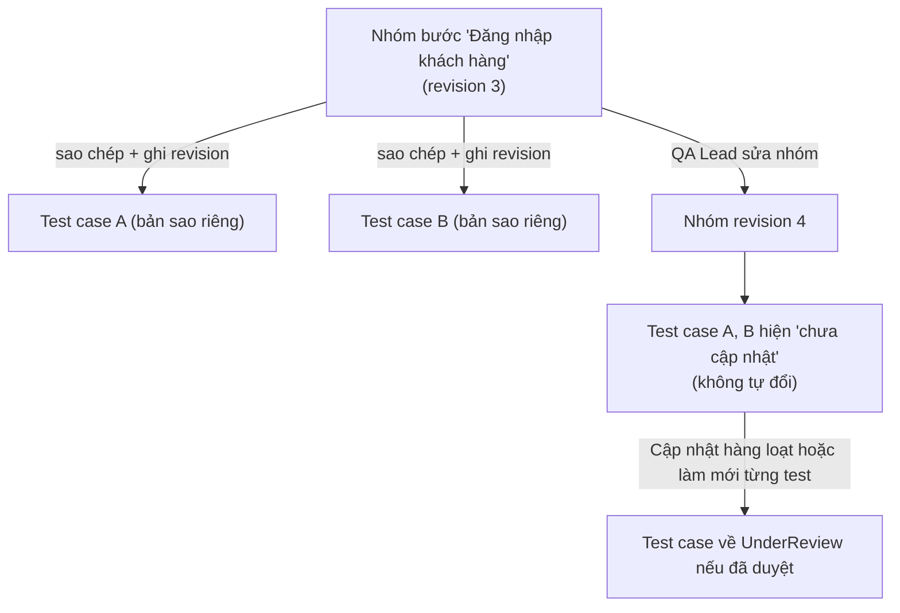

- Nhóm bước được viết một lần ở thư viện và **sao chép** vào nhiều test case; test case giữ bản sao của riêng nó cùng revision đã chép.
- Sửa nhóm **không** làm thay đổi test case, phiên bản hay run đã có. Test case đang giữ revision cũ được đánh dấu "chưa cập nhật"; cập nhật hàng loạt hoặc làm mới từng test case đưa chúng lên revision mới (test case đã duyệt quay về duyệt lại).
- Sửa một bước đã chép, hoặc gỡ liên kết, biến bước đó thành của riêng test case. Nhóm đang được dùng thì không xóa được.

### 5.4. Kế hoạch và thực thi

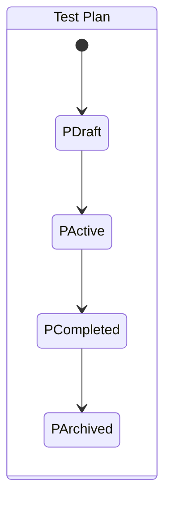

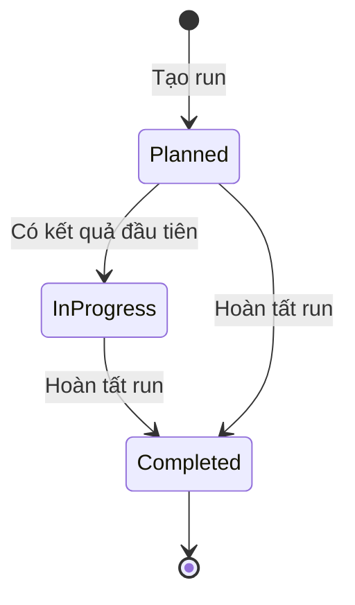

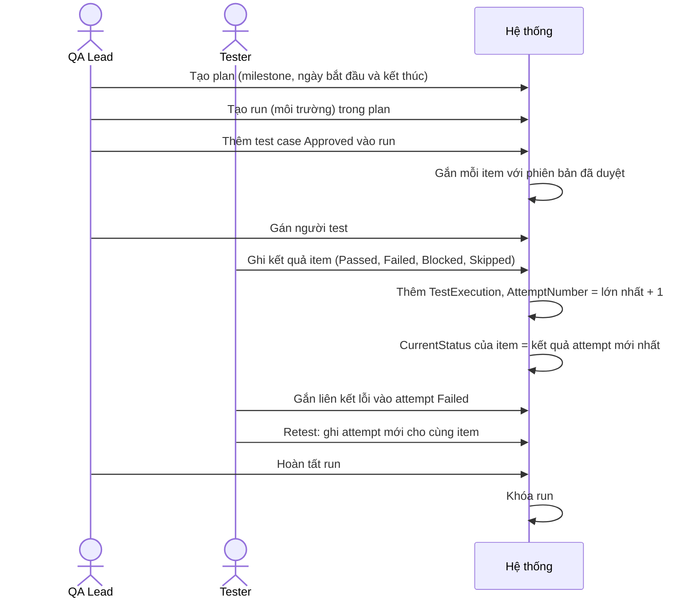

**Mô tả:**
- Mỗi run item có **1..N lần chạy** (`TestExecution`). Lần chạy cũ giữ nguyên; trạng thái hiện tại của item là kết quả lần chạy mới nhất. Retest chính là ghi thêm một attempt.
- Mỗi attempt lưu kết quả thực tế, thời lượng, người chạy và thời điểm (audit ABP), đính kèm và liên kết lỗi.
- **Chạy hàng loạt** (batch) cho run hồi quy lớn.
- **Kết quả theo từng bước:** khi ghi một lần chạy, tester có thể ghi thêm kết quả cho từng bước của phiên bản đang chạy (Passed, Failed, Blocked, Skipped; kèm ô "thực tế ghi nhận" cho bước không đạt). Việc này **không bắt buộc** và bước nào không chạy thì để "Chưa chạy" (không ghi dòng nào). Kết quả của cả lần chạy vẫn do tester chọn; giao diện giúp bằng cách đổi sang Failed khi có bước Failed, sang Blocked khi có bước Blocked mà không bước nào Failed, và có nút "Tất cả các bước đạt". Hệ thống từ chối một lần chạy **Passed** mà có bước Failed hoặc Blocked, từ chối bước không thuộc phiên bản đang chạy (kể cả bước của bản mới hơn sau khi test case được sửa) và bước ghi hai lần. Kết quả bước nằm trong lần chạy của nó, nên retest ghi bộ kết quả riêng; chỉ thêm, không sửa. Màn lịch sử các lần chạy hiện kết quả từng bước kèm nội dung bước. Chỉ số của run, dashboard, RTM và Quality Gate vẫn tính trên kết quả cả lần chạy; kết quả theo bước chưa có trong xuất Excel, CSV hay biên bản nghiệm thu.
- **Run** chuyển Planned → InProgress khi có kết quả đầu tiên → Completed. Run đã hoàn tất bị **khóa**: không ghi kết quả, không thêm item. (Hệ thống không có thao tác bớt item khỏi một run.) **Xóa run:** run **chưa có kết quả nào** (không có lần chạy nào, mọi item còn Untested) xóa được, dù đã hoàn tất hay chưa; các test case của run đó lại tự do để đưa vào run khác. Run đã có dù chỉ một lần chạy thì không xóa được, vì là một phần của lịch sử; hãy hoàn tất run. Cần quyền `TestPlans.Manage`; giao diện chỉ hiện nút Xóa ở những run đủ điều kiện, có hỏi xác nhận.
- **Plan** có ngày bắt đầu và kết thúc (kiểm tra hợp lệ), có thể gắn milestone; plan còn run thì không xóa được; plan lưu trữ không thêm run.
- **Gán người test** theo từng item; host cung cấp danh sách người dùng qua `TCM_USER_DIRECTORY` (mặc định dùng tra cứu người dùng của ABP).
- **Giao diện danh sách run:** mặc định nhóm theo plan (mở / đóng từng nhóm, nhóm "Runs without a plan" cho run không thuộc plan, hiển thị số run, trạng thái, ngày), có chế độ danh sách phẳng với lọc theo từ khóa, plan, trạng thái, môi trường và phân trang. Mỗi run hiện tiến độ, số đạt, số không đạt.

### 5.5. Lỗi (Defect) và issue tracker

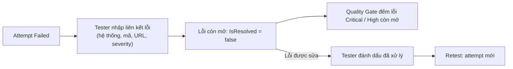

- Liên kết lỗi chỉ gắn được vào **attempt Failed**, không trùng trong cùng attempt; URL được kiểm tra hợp lệ.
- Thông tin: tên hệ thống quản lý lỗi, mã issue, URL, severity (Low / Medium / High / Critical), đã xử lý hay chưa.
- Quality Gate đếm **theo từng issue** (hệ thống + mã, không phân biệt hoa thường) còn liên kết chưa xử lý.
- Người dùng **nhập mã và URL lỗi** thủ công; hệ thống không kết nối với công cụ quản lý lỗi bên ngoài.

### 5.6. Requirement và truy vết (RTM)

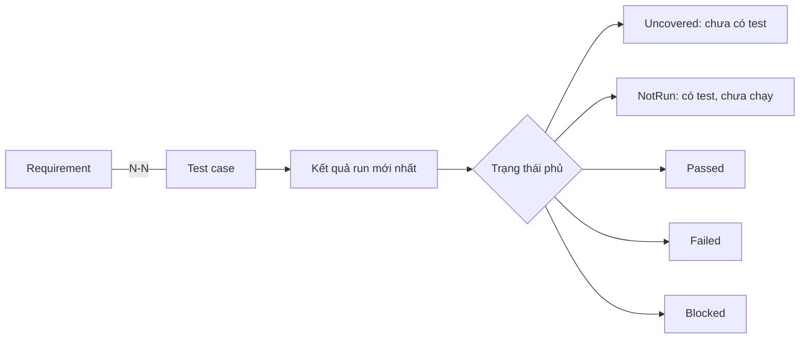

- Requirement có mã duy nhất, tiêu đề, mô tả, tiêu chí chấp nhận, ưu tiên, milestone tùy chọn.
- RTM phân biệt **được phủ** (có test case) với **đã đạt** (test case chạy Passed) và hiện lỗi đang chặn; lọc theo dự án.

### 5.7. Quality Gate và nghiệm thu

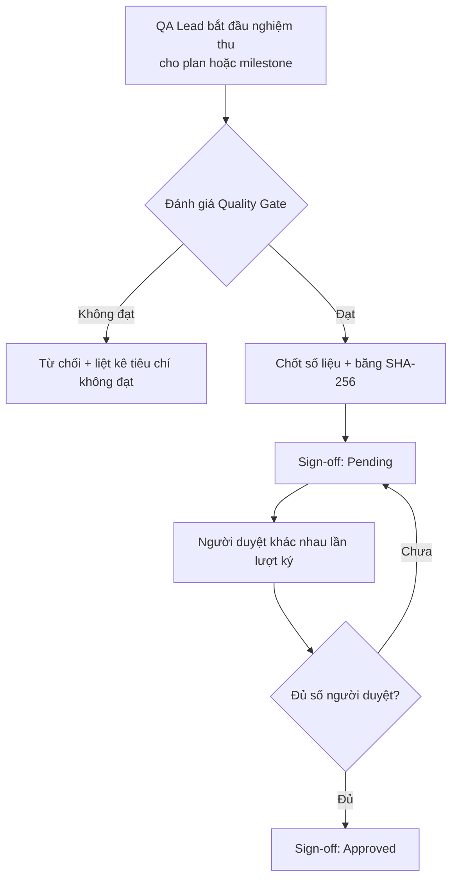

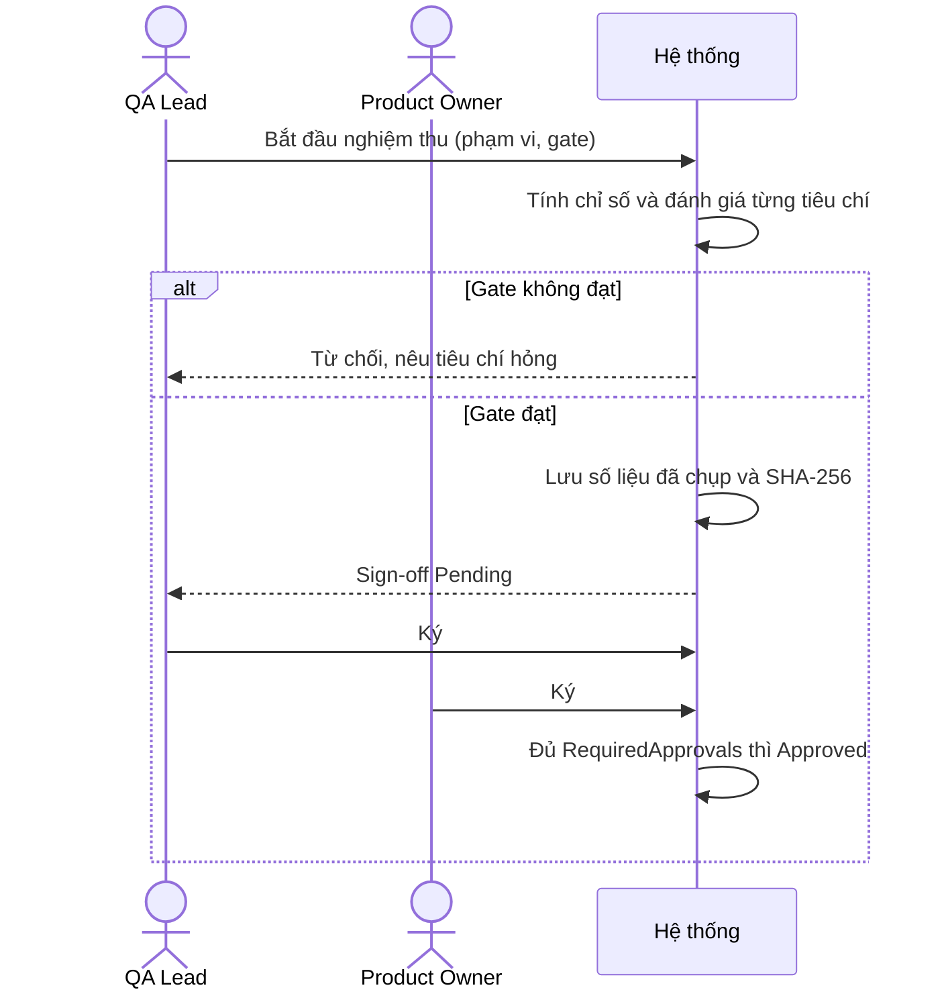

**Tiêu chí của Quality Gate:**

| # | Tiêu chí | Điều kiện đạt |
| :--- | :--- | :--- |
| 1 | Tỷ lệ đạt (pass rate) | Passed ÷ (tổng item − Skipped) ≥ `MinPassRate` (mặc định 95), so sánh tỷ lệ chính xác |
| 2 | P1 đã chạy hết | Mọi item có ưu tiên `Urgent` (gọi là P1) tại phiên bản đã chạy đều có kết quả Passed hoặc Failed |
| 3 | Không còn lỗi Critical mở | Số issue Critical chưa xử lý = 0 |
| 4 | Không còn lỗi High mở | Số issue High chưa xử lý = 0 |

**Mô tả:**
- Quality Gate có tên, mô tả, `MinPassRate`, `RequiredApprovals` (mặc định 2, tối đa 10), có thể đặt mặc định. Có chế độ đánh giá thử (`quality-gates/evaluate`) hiển thị từng tiêu chí.
- **Không có cơ chế bỏ qua (override):** gate không đạt thì không nghiệm thu được.
- Sign-off gắn với **plan hoặc milestone**, trong phạm vi một dự án; chụp lại số liệu (`SummaryStatsJson`), tên và ngưỡng của gate lúc chốt, và `SnapshotHash` SHA-256; trạng thái Pending, Approved, Superseded.
- Mỗi người duyệt chỉ ký một lần; người ký phải là người dùng có id; hoàn tất khi đủ số người duyệt khác nhau.
- **Mã băm SHA-256** được tính trên chuỗi JSON của số liệu đã chốt (`SummaryStatsJson`) và lưu **cùng chỗ** với dữ liệu. Nó giúp phát hiện số liệu bị sai lệch vô ý hoặc sửa lẫn lộn, nhưng người có quyền ghi trực tiếp vào cơ sở dữ liệu có thể tính lại mã băm sau khi sửa. Nó **không phải chữ ký số** và không chống chối bỏ. Nếu cần chống sửa có chủ ý, hướng nâng cấp là dùng HMAC với khóa giữ ngoài cơ sở dữ liệu.
- **Superseded:** khi bắt đầu một nghiệm thu mới cho cùng phạm vi (cùng plan hoặc milestone, cùng dự án), mọi nghiệm thu còn Pending của phạm vi đó tự chuyển sang Superseded. Nghiệm thu đã Approved không bị đổi.
- **Người ký:** hệ thống kiểm số người duyệt khác nhau (`RequiredApprovals`) và quyền `SignOff.Approve`; **không kiểm theo vai trò** (ví dụ cần đúng một QA Lead và một Product Owner). Ai được cấp quyền này do cấu hình vai trò của host quyết định.
- **Điều kiện phạm vi:** hệ thống không bắt buộc mọi run trong plan hoặc milestone phải Completed trước khi nghiệm thu; số liệu được tính trên trạng thái hiện tại của các run trong phạm vi.
- Hoàn tất một run **không** bị gate chặn; gate áp dụng ở bước nghiệm thu.

### 5.8. Nhập và xuất dữ liệu

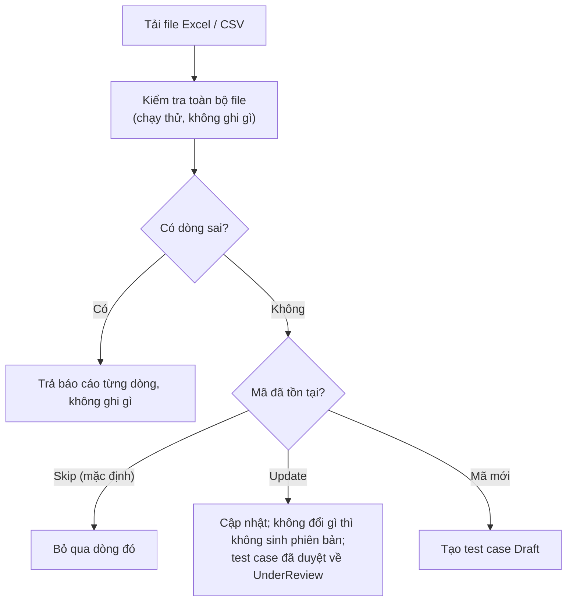

**Test case** (mỗi dòng một bước; các dòng cùng `Code` là một test case):
`Suite, Code, Title, Description, Preconditions, Postconditions, Priority, Severity, Kind, Layer, ExecutionType, Flaky, Status, Version, StepNo, Action, ExpectedResult, TestData` (và cột `Tags` cách nhau bằng dấu chấm phẩy).
- `Suite` là đường dẫn như `Payments/Cards`; suite chưa có sẽ được tạo nếu người nhập có quyền quản lý suite. `Status`, `Version`, `StepNo` chỉ để tham khảo khi nhập.
- Nhập vào dự án nào theo tham số `ProjectId`, bỏ trống thì vào dự án mặc định.
- **Tất cả hoặc không gì:** một dòng sai thì chặn cả file. `DryRun=true` trả báo cáo từng dòng (Created, Updated, Skipped, Invalid, thông báo theo ngôn ngữ) mà không ghi gì.
- Cột file không có thì giữ nguyên trường; ô trống trong cột có mặt thì xóa trường.

**Kết quả chạy:** xuất `Code, Title, Version, Attempt, Result, ActualResult, DurationSeconds, Defects, ExecutedAt, ExecutedBy` (mỗi attempt một dòng); nhập chỉ cần `Code` và `Result`, mỗi dòng thành một attempt mới.

**Giới hạn và bảo mật:** 5 MiB, 10.000 dòng, 50 MiB sau giải nén, 20.000 test case mỗi lần xuất (`TestCaseManagementTransferOptions`). CSV là UTF-8 có BOM, đọc được dấu phẩy, chấm phẩy, tab; ô có thể chạy như công thức Excel được thêm dấu nháy đơn khi xuất.
**Quyền:** xuất = quyền đọc; nhập test case = `TestCases.Create` (`Update` để cập nhật, `TestSuites.Manage` để tạo suite); nhập kết quả = `TestRuns.Execute`.

### 5.9. Gợi ý bước bằng AI

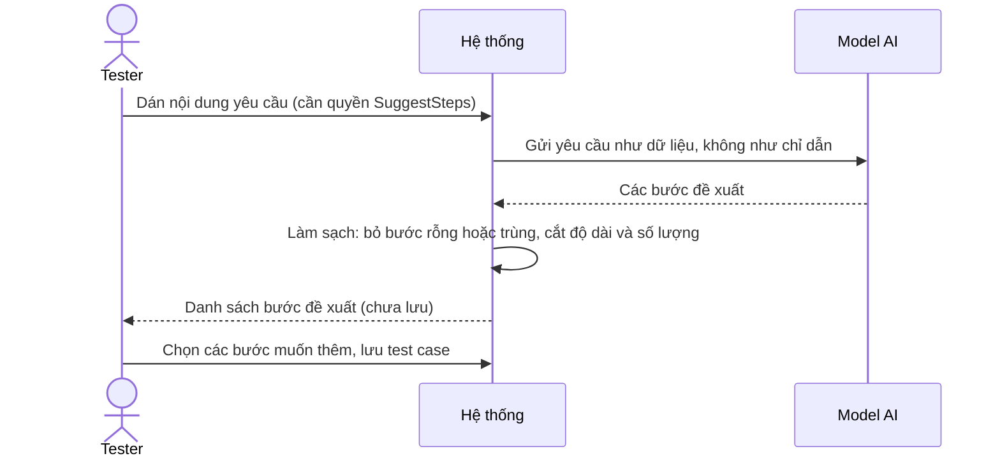

- Bật bằng cấu hình `TestCaseManagement:AiSuggestions` (`Endpoint` chat completions, `ApiKey`, `Model`…); không cấu hình thì tính năng tắt và nút không hiện.
- Chạy được với OpenAI hoặc model nội bộ (Ollama, vLLM, LM Studio) nên nội dung có thể không rời mạng công ty. Thay được bằng `IStepSuggestionProvider` riêng.
- Khóa AI không bao giờ được lưu, hiển thị, trả về, ghi log; audit của lời gọi không giữ nội dung yêu cầu. Chưa có hạn mức hay giới hạn tần suất.

---

## 6. DANH MỤC USE CASE

### 6.1. Sơ đồ Use Case

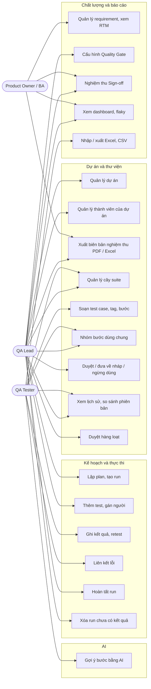

### 6.2. Danh sách Use Case

| Mã | Use case | Actor | Mô tả |
| :--- | :--- | :--- | :--- |
| UC-01 | Quản lý dự án | QA Lead | Tạo (key không đổi), sửa tên và mô tả, lưu trữ, khôi phục, xóa khi trống |
| UC-02 | Chọn dự án đang làm việc | Mọi người | Chọn ở thanh đầu trang; mọi trang theo dự án đó |
| UC-03 | Quản lý cây suite | QA Lead, Tester | Tạo, đổi tên, di chuyển, xóa; chặn vòng lặp; xóa suite chỉ khi trống |
| UC-04 | Soạn test case | Tester | Mã, tiêu đề, mô tả, tiền và hậu điều kiện, ưu tiên, severity, loại, tầng, cách chạy, bước, tag |
| UC-05 | Gửi duyệt | Tester | Draft sang UnderReview |
| UC-06 | Duyệt / trả về nháp | QA Lead | Duyệt sinh phiên bản; trả về nháp để sửa |
| UC-07 | Ngừng dùng test case | QA Lead | Deprecated; không thêm vào run mới |
| UC-08 | Xem và so sánh phiên bản | Tester, QA Lead | Xem danh sách và nội dung các phiên bản; so sánh hai phiên bản bất kỳ (trường, từng từ, từng bước) |
| UC-09 | Quản lý nhóm bước dùng chung | QA Lead, Tester | Tạo, sửa, xem nơi dùng, chèn vào test case, làm mới, cập nhật hàng loạt |
| UC-10 | Gắn tag và lọc | Tester | Tag không sinh phiên bản; lọc cùng lúc theo nhiều tag |
| UC-11 | Đính kèm file | Tester | Ảnh (dán từ clipboard), log, video cho test case hoặc attempt |
| UC-12 | Lập test plan | QA Lead | Tên, mô tả, milestone, ngày, trạng thái |
| UC-13 | Tạo test run | QA Lead | Trong plan hoặc đứng riêng; môi trường |
| UC-14 | Thêm test vào run, gán người | QA Lead | Chọn test case có phiên bản đã duyệt đang dùng (kể cả test case chờ duyệt lại); gán người test |
| UC-15 | Ghi kết quả | Tester | Đơn lẻ hoặc hàng loạt; kết quả thực tế, thời lượng |
| UC-16 | Retest | Tester | Ghi attempt mới cho cùng item |
| UC-17 | Liên kết lỗi | Tester | Gắn lỗi vào attempt Failed; đánh dấu đã xử lý |
| UC-18 | Hoàn tất run | QA Lead | Khóa run |
| UC-19 | Quản lý requirement, liên kết test case | BA, Tester | Requirement và liên kết N–N |
| UC-20 | Xem ma trận truy vết RTM | QA Lead, BA, PO | Độ phủ và trạng thái đạt |
| UC-21 | Quản lý Quality Gate | QA Lead | Ngưỡng, số người duyệt, đánh giá thử |
| UC-22 | Nghiệm thu (Sign-off) | QA Lead, PO | Đánh giá gate, chốt số liệu, nhiều người ký |
| UC-23 | Xem dashboard | QA Lead, PM, PO | Tiến độ, tốc độ, burn-down, mật độ lỗi |
| UC-24 | Phát hiện và đánh cờ flaky | QA Lead | Chấm điểm; ghi cờ Flaky vào thư viện |
| UC-25 | Nhập test case, kết quả | Tester | Excel / CSV, chạy thử trước |
| UC-26 | Xuất test case, kết quả | Tester | Excel / CSV theo bộ lọc |
| UC-27 | Gợi ý bước bằng AI | Tester | Đề xuất, xem, chọn thêm |
| UC-28 | Xem lịch sử thay đổi của test case | Tester, QA Lead | Dòng thời gian: tạo, sửa (các trường), trạng thái, phiên bản, tag, bước, nhóm bước dùng chung |
| UC-29 | Xóa run chưa có kết quả | QA Lead | Xóa run tạo nhầm; không xóa run đã có kết quả |
| UC-30 | Duyệt hàng loạt test case | QA Lead | Chọn nhiều test case và duyệt một lần; báo cáo các test case không duyệt được kèm lý do |
| UC-31 | Quản lý thành viên của dự án | QA Lead | Đặt dự án chỉ cho thành viên xem; thêm, bớt thành viên |
| UC-32 | Xuất biên bản nghiệm thu ra PDF hoặc Excel | QA Lead, PO | PDF A4 để in và ký, hoặc Excel nhiều trang tính; nội dung là số liệu đã chốt lúc nghiệm thu |
| UC-33 | Nhân bản test case | Tester | Tạo bản sao Nháp của test case, mã kế tiếp của dự án, chép nội dung, bước và tag |
| UC-34 | Ghi kết quả theo từng bước | Tester | Trong lúc ghi một lần chạy, chọn kết quả và ghi nhận thực tế cho từng bước của phiên bản; xem lại trong lịch sử các lần chạy |

---

## 7. QUY TẮC NGHIỆP VỤ

### 7.1. Test case
| Mã | Quy tắc | Khi vi phạm |
| :--- | :--- | :--- |
| BR-TC-01 | Phải có ít nhất 1 bước mới được gửi duyệt hoặc duyệt | `TestCaseHasNoSteps` |
| BR-TC-02 | `Code` duy nhất trong toàn thư viện (kể cả giữa các dự án) | `DuplicateTestCaseCode` |
| BR-TC-03 | Chỉ chuyển trạng thái theo sơ đồ 5.2 | `InvalidTestCaseStatusTransition` |
| BR-TC-04 | Duyệt sinh phiên bản mới; sửa test case đã duyệt đưa về UnderReview, phiên bản cũ vẫn là bản đang dùng | |
| BR-TC-05 | Người duyệt được phép là tác giả; ghi chú thay đổi không bắt buộc | |
| BR-TC-06 | Test case phải có phiên bản đã duyệt đang dùng (Approved, hoặc UnderReview sau một lần duyệt) mới vào được run | `TestCaseNotApproved` |
| BR-TC-07 | Tag: tối đa 20, mỗi tag tối đa 50 ký tự, không chứa `,` hay `;` | `InvalidTag`, `TooManyTags` |
| BR-TC-08 | Thứ tự bước phải hợp lệ khi sắp xếp lại | `InvalidStepOrder` |
| BR-TC-09 | Cây thư viện không chứa Sprint hay Milestone | |
| BR-TC-10 | Xóa test case là xóa mềm | |
| BR-TC-12 | Tạo test case không có mã thì dự án của suite cấp mã `KEY-nnn` kế tiếp: bộ đếm chỉ tăng, bỏ qua mã đã có, mã gõ tay không dùng số của dự án; sửa mà để trống mã thì giữ mã cũ | `TestCaseCodeNotGenerated` (khi hết 10.000 lần thử), `DuplicateTestCaseCode` (mã gõ tay trùng) |
| BR-TC-13 | Nhân bản tạo test case Nháp mới, không có phiên bản, requirement, run, file đính kèm hay Automation ID của bản gốc; mã và suite của bản sao theo đúng quy tắc tạo mới (suite không được thuộc dự án đã lưu trữ) | `DuplicateTestCaseCode`, `SuiteNotFound`, `ProjectArchived` |
| BR-TC-11 | Duyệt hàng loạt: từng test case theo đúng quy tắc duyệt riêng; test case không duyệt được giữ nguyên và được báo lý do; tối đa 200 test case mỗi lần | `TestCaseHasNoSteps`, `InvalidTestCaseStatusTransition`, `TestCaseNotFound` (báo trong kết quả, không dừng cả lượt) |

### 7.2. Phiên bản
| Mã | Quy tắc |
| :--- | :--- |
| BR-VER-01 | `TestCaseVersion` bất biến: không có API sửa phiên bản |
| BR-VER-02 | Phiên bản chứa trọn nội dung, bước và phân loại (ưu tiên, severity, loại, tầng, cách chạy) tại lúc duyệt; plan và run luôn trỏ phiên bản đã chốt |
| BR-VER-03 | Các chỉ số tính trên kết quả đã chạy (ví dụ tiêu chí P1 của Quality Gate) dùng ưu tiên **của phiên bản đã chạy**; đổi ưu tiên trong thư viện về sau không làm đổi kết quả đã có. Phiên bản cũ chưa có snapshot thì dùng giá trị hiện tại của test case |

### 7.3. Plan, Run, Execution
| Mã | Quy tắc | Khi vi phạm |
| :--- | :--- | :--- |
| BR-RUN-01 | Run item bắt buộc có `TestCaseVersionId` | |
| BR-RUN-02 | Run đã hoàn tất thì không ghi kết quả, không thêm item | `TestRunAlreadyCompleted` |
| BR-RUN-11 | Kết quả theo bước: mỗi bước phải thuộc phiên bản mà item chạy, mỗi bước tối đa một lần trong một lần chạy, trạng thái của bước không được là Untested, tối đa 500 bước | `TestStepNotInVersion`, `DuplicateStepResult`, `InvalidExecutionStatus` |
| BR-RUN-12 | Lần chạy Passed không được có bước Failed hoặc Blocked; bước Skipped thì được. Khi bị từ chối, không có gì được ghi (cả lần chạy lẫn kết quả bước; với chạy hàng loạt là cả lượt) | `PassedWithUnpassedStep` |
| BR-RUN-13 | Kết quả bước chỉ thêm cùng lần chạy, không sửa, không xóa; không ảnh hưởng trạng thái item, chỉ số run, RTM, dashboard hay Quality Gate | |
| BR-RUN-10 | Chỉ xóa được run chưa có kết quả nào (không có lần chạy, mọi item Untested); xóa run cũng xóa các item của nó | `TestRunHasResults` |
| BR-RUN-03 | `AttemptNumber` = lớn nhất hiện có + 1; không sửa, không xóa attempt | |
| BR-RUN-04 | Trạng thái hiện tại của item là kết quả attempt cuối | |
| BR-RUN-05 | Một test case chỉ một lần trong một run | `TestCaseAlreadyInRun`, `DuplicateTestRunItem` |
| BR-RUN-06 | Plan còn run thì không xóa; plan lưu trữ không thêm run; ngày hợp lệ | `TestPlanHasRuns`, `TestPlanArchived`, `InvalidTestPlanDates` |
| BR-RUN-07 | Liên kết lỗi chỉ cho attempt Failed, không trùng; URL hợp lệ | `DefectRequiresFailedExecution`, `DuplicateDefectLink`, `InvalidDefectUrl` |
| BR-RUN-08 | Gate không đạt thì không nghiệm thu; không có override | `QualityGateNotPassed` |
| BR-RUN-09 | Sign-off phải có phạm vi hợp lệ và không rỗng; mỗi người ký một lần; người ký có id | `InvalidSignOffScope`, `SignOffScopeEmpty`, `DuplicateSignOffApproval`, `SignOffRequiresUser` |

### 7.4. Suite và Dự án
| Mã | Quy tắc | Khi vi phạm |
| :--- | :--- | :--- |
| BR-MOD-01 | Không tạo vòng lặp khi di chuyển suite | `CircularSuiteDependency` |
| BR-MOD-02 | Không xóa suite còn test case hoặc suite con | `SuiteNotEmpty` |
| BR-PRJ-01 | `Key` 2–10 ký tự chữ hoa hoặc số, bắt đầu bằng chữ, duy nhất, không đổi | `InvalidProjectKey`, `DuplicateProjectKey` |
| BR-PRJ-02 | Không trộn dự án giữa suite, test case, run, plan, requirement | `DifferentProject` |
| BR-PRJ-03 | Dự án lưu trữ không thêm được gì; chỉ xóa dự án khi trống | `ProjectArchived`, `ProjectNotEmpty` |
| BR-PRJ-04 | Dự án "chỉ thành viên": chỉ thành viên và người có quyền `Projects.Manage` thấy dự án và dữ liệu trong đó; với người khác dữ liệu đó là "không tìm thấy" | HTTP 404 khi gọi theo id; không có trong danh sách |
| BR-PRJ-05 | Chỉ người có quyền `Projects.Manage` đọc hoặc đổi danh sách thành viên và cờ hạn chế | HTTP 403 |
| BR-PRJ-06 | Danh sách thành viên bị thay bằng danh sách gửi lên (tối đa 500 người, bỏ trùng); danh sách còn lại khi tắt cờ nhưng không có tác dụng | |

### 7.5. Đính kèm
| Mã | Quy tắc | Khi vi phạm |
| :--- | :--- | :--- |
| BR-ATT-01 | Chỉ cho phép: ảnh, PDF, văn bản và log, file nén, file Office, video ngắn; không SVG, không HTML | `AttachmentTypeNotAllowed` |
| BR-ATT-02 | Tối đa 25 MB mỗi file | `AttachmentTooLarge` |
| BR-ATT-03 | Tối đa 25 file cho mỗi chủ sở hữu (test case hoặc attempt) | `AttachmentTooMany` |
| BR-ATT-04 | Quyền của file theo quyền của thứ nó gắn vào; tải xuống luôn là attachment với content type cố định | |

Giới hạn cấu hình qua `TestCaseManagementAttachmentOptions`.

---

## 8. BÁO CÁO VÀ CHỈ SỐ

### 8.1. Chỉ số

| # | Chỉ số | Công thức | Nơi dùng |
| :--- | :--- | :--- | :--- |
| 1 | Pass rate | Passed ÷ (tổng item − Skipped), theo trạng thái hiện tại | Dashboard, Quality Gate |
| 2 | Tiến độ run | số item đã có kết quả ÷ tổng item, làm tròn 2 chữ số | Danh sách và chi tiết run |
| 3 | First-time pass rate | tỷ lệ item Passed ngay lần chạy đầu | Chi tiết run |
| 4 | Tốc độ thực thi | số lần chạy theo ngày; trung bình mỗi ngày và trung bình 7 ngày gần nhất | Dashboard |
| 5 | Burn-down | số item chưa chạy giảm theo ngày | Dashboard |
| 6 | Mật độ lỗi | số lỗi trên 100 test đã chạy; lỗi mở và đã xử lý; tỷ lệ test có lỗi | Dashboard |
| 7 | Điểm flaky | số lần kết quả đổi ÷ (số kết quả − 1), trên 20 kết quả Passed hoặc Failed gần nhất; từ 0,15 là Watch, từ 0,30 là Flaky; dưới 5 kết quả thì chưa đủ dữ liệu (`Insufficient`). Tính theo test case, gộp các lần chạy ở mọi phiên bản, nên một lần sửa bước test cũng có thể làm kết quả đổi | Dashboard, cờ trong thư viện |
| 8 | Độ phủ yêu cầu | requirement có ít nhất 1 test case so với tổng; kèm đã đạt | RTM |
| 9 | P1 executed | số item có ưu tiên Urgent (P1) tại phiên bản đã chạy mà đã có Passed hoặc Failed | Quality Gate |
| 10 | Lỗi mở theo severity | số issue còn liên kết chưa xử lý | Quality Gate |

Mọi chỉ số lọc được theo **dự án**; dashboard còn lọc theo plan và theo số ngày (`Days`). Ngưỡng và cửa sổ của flaky cấu hình qua `TestCaseManagementInsightsOptions`.

### 8.2. Màn hình và báo cáo

| Báo cáo | Nội dung |
| :--- | :--- |
| Dashboard | Tiến độ, tốc độ, burn-down, mật độ lỗi, flaky của một plan hoặc của mọi run |
| RTM | Requirement, test case liên kết, kết quả mới nhất, lỗi đang chặn |
| Chi tiết run | Danh sách item, người được gán, lịch sử attempt, lỗi |
| Quality Gate | Đánh giá từng tiêu chí |
| Sign-off | Kết quả nghiệm thu: phạm vi, số liệu đã chụp, người ký, băng SHA-256 |
| Xuất dữ liệu | Thư viện test và kết quả run dạng Excel hoặc CSV |
| Biên bản nghiệm thu (file) | PDF khổ A4 có chỗ ký tay, hoặc sổ Excel nhiều trang tính (xem 8.4) |

### 8.3. Nội dung biên bản nghiệm thu được chốt
Tên sign-off; phạm vi (plan hoặc milestone); tên và ngưỡng của Quality Gate tại thời điểm chốt; số liệu tổng hợp (`SummaryStatsJson`); `SnapshotHash` SHA-256; danh sách người ký (tên, vai trò, thời điểm, nhận xét).

### 8.4. Biên bản nghiệm thu thành file (PDF và Excel)

Từ trang "Quality and sign-off", mỗi biên bản có nút **PDF** và **Excel** (cũng có trong màn chi tiết biên bản). File nói **đúng những gì đã chốt lúc nghiệm thu**, nên mở lúc nào cũng cho kết quả như nhau; không đọc lại số liệu hiện tại của thư viện.

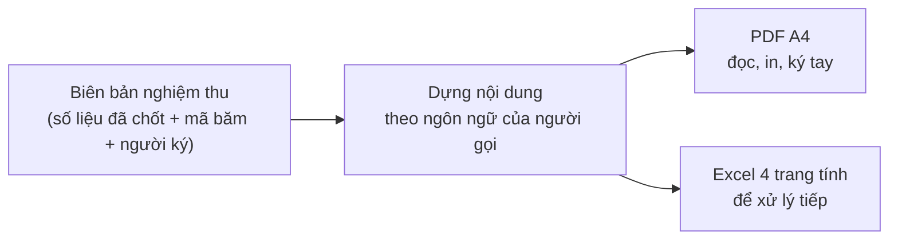

| Phần | Nội dung |
| :--- | :--- |
| 1. Thông tin chung | Tên biên bản, dự án, phạm vi (các plan hoặc milestone), cổng chất lượng và ngưỡng, số người duyệt cần có, trạng thái, ngày tạo, ngày hoàn tất duyệt, thời điểm đánh giá, kết quả cổng, mã băm SHA-256 và kết quả kiểm tra khớp mã băm |
| 2. Tổng hợp kết quả | Số run, số test case, đạt, không đạt, bị chặn, bỏ qua, chưa chạy, tiến độ, tỷ lệ đạt, đạt ngay lần đầu, test ưu tiên cao nhất đã chạy |
| 3. Cổng chất lượng | Từng tiêu chí: yêu cầu, thực tế, đạt hay không |
| 4. Lỗi đang mở | Số lỗi theo mức nghiêm trọng và danh sách lỗi (hệ thống, mã, mức, đường dẫn) |
| 5. Phê duyệt | Từng người duyệt: họ tên, vai trò, thời gian, nhận xét, chữ ký (mã băm; PDF in 16 ký tự đầu, Excel đủ) |
| 6. Chữ ký (chỉ PDF) | Hai khối để ký tay: người lập và người nghiệm thu, kèm họ tên và ngày |

**Quy tắc:**

| Mã | Quy tắc |
| :--- | :--- |
| BR-RPT-01 | Xuất cần quyền đọc nghiệm thu (`SignOff.Default`); biên bản thuộc dự án người gọi không thấy thì "không tìm thấy" |
| BR-RPT-02 | Nội dung lấy từ bản chốt của biên bản, không từ dữ liệu hiện tại; thời gian ghi theo UTC |
| BR-RPT-03 | Chữ và nhãn theo ngôn ngữ của người gọi (tiếng Anh hoặc tiếng Việt, theo `Accept-Language`) |
| BR-RPT-04 | Biên bản mà số liệu không còn khớp mã băm vẫn xuất được và ghi rõ "số liệu KHÔNG khớp với mã băm" |

**Kỹ thuật:** PDF tạo bằng PDFsharp và MigraDoc (giấy phép MIT), với **phông Noto Sans nhúng sẵn trong module** (giấy phép SIL OFL, đã cắt gọn còn chữ Latin và tiếng Việt, khoảng 330 KB) nên file giống nhau trên mọi máy chủ và có đủ dấu tiếng Việt. Excel tạo bằng Open XML. Tên file có dạng `signoff-<tên biên bản không dấu>-<ngày tạo>.pdf` hoặc `.xlsx`.

---

## 9. YÊU CẦU PHI CHỨC NĂNG

| Nhóm | Nội dung |
| :--- | :--- |
| **Bảo mật** | Mọi application service yêu cầu quyền; khóa AI không lưu, không log; tải xuống đính kèm dùng content type cố định; không cho SVG và HTML; ô CSV có thể chạy như công thức được chặn bằng dấu nháy đơn |
| **Đa tenant** | Mọi thực thể có `TenantId` và dùng bộ lọc truy vấn toàn cục của ABP |
| **Audit** | Dùng audit của ABP (người tạo, người sửa, thời gian, xóa mềm); người ghi kết quả và người ký được lưu |
| **Toàn vẹn dữ liệu** | Phiên bản và attempt bất biến; nhập dữ liệu tất cả hoặc không gì; sign-off có băng SHA-256; khóa tuần tự cho nghiệm thu, gate mặc định (trong tiến trình; nhiều máy chủ cần distributed lock) |
| **Hiệu năng** | Danh sách test case phân trang, dưới 1 giây; dashboard và flaky đọc dữ liệu phạm vi vào bộ nhớ, khoảng 6 giây ở 100.000 run item trên MySQL |
| **Đa ngôn ngữ** | Tiếng Anh và tiếng Việt cho giao diện, thông báo lỗi nghiệp vụ và báo cáo nhập dữ liệu |
| **Khả năng chạy trên nhiều CSDL** | Đã chạy trên SQLite và MySQL 8.4 (bản 8.4.11, bộ test chạy lại đầy đủ ngày 2026-10-13) |
| **Khả năng mở rộng** | Thay nhà cung cấp AI bằng `IStepSuggestionProvider`; thay nguồn danh sách người dùng bằng `TCM_USER_DIRECTORY` |
| **Đóng gói** | `build/build.ps1` restore, build, test, pack `.nupkg` và `.snupkg` (Windows PowerShell 5.1 và PowerShell 7, .NET SDK 10) |

---

## 10. TÍCH HỢP VÀO ỨNG DỤNG ABP CỦA CÔNG TY

### 10.1. Phía máy chủ
1. Host dùng ABP từ 10.6.1 trở lên.
2. Tham chiếu 6 dự án (hoặc gói) và thêm từng module vào `[DependsOn]` đúng tầng.
3. Nhúng model vào DbContext của host (`[ReplaceDbContext]`, đủ `DbSet`, `builder.ConfigureTestCaseManagement(this)`), tạo migration, chạy migrator. Vai trò admin của template được cấp quyền của module khi seed.
4. Cần các `DbSet`: `Project`, `TestSuite`, `TestCase`, `SharedStepGroup`, `TestPlan`, `TestRun`, `Requirement`, `QualityGate`, `SignOffReport`, `Attachment`, `TestCaseHistoryEntry`, `ProjectMember` cùng các bảng con của module.
5. Cấu hình provider BlobStoring cho file đính kèm.
6. Thêm `vi` vào `AbpLocalizationOptions.Languages` nếu cần tiếng Việt.

### 10.2. Phía Angular
1. Sao chép `angular/projects/test-case-management/` vào ứng dụng, thêm `paths` trong `tsconfig.json`.
2. `app.config.ts`: `provideTestCaseManagementForAbp()` và `provideTestCaseManagementMenu()`.
3. `app.routes.ts`: route `test-case-management` nạp `createTestCaseManagementRoutes`.

### 10.3. Đã chạy thử
Module đã được cắm vào một ứng dụng sinh từ template ABP (Angular, LeptonX, OpenIddict) và chạy trên trình duyệt, kể cả luồng nhiều dự án.

---

## 11. KIỂM THỬ VÀ CHẤT LƯỢNG

| Loại | Kết quả gần nhất |
| :--- | :--- |
| Domain test | 219 test đạt |
| Application test | 442 test đạt |
| HttpApi test (gồm hợp đồng OpenAPI) | 84 test đạt |
| Angular test | 233 test đạt (35 file) |
| Chạy trên SQLite | Đạt |
| Chạy trên MySQL 8.4.11 | Đạt cả ba bộ test (Domain 219, Application 442, HttpApi 84), chạy tuần tự ngày 2026-10-13, sau khi thêm mã tự sinh, nhân bản và kết quả theo bước |
| Cắm vào ứng dụng ABP sinh từ template, chạy MySQL | Ở lần chạy trước khi có kết quả theo bước: migration tạo đủ 22 bảng `Tcm*`; máy chủ ABP chạy trên MySQL và các luồng chính qua API đều đạt (dự án, test case, phiên bản, lịch sử, run, kết quả, truy vết, cổng chất lượng, nhập/xuất, nghiệm thu, xóa run) |
| Chạy thử trình duyệt trên ứng dụng ABP mẫu | Đã chạy các luồng chính, kể cả hai dự án |

Migration `AddStepResultsAndCodeCounter` (bảng `TcmTestStepResults` và cột `TcmProjects.LastTestCaseNumber`) mới chạy trên SQLite của ứng dụng ABP mẫu, chưa chạy trên MySQL của ứng dụng đó (các test của module đã tạo đúng cấu trúc trên MySQL). Mã tự sinh khi hai người tạo cùng lúc trong một dự án chưa thử với hai yêu cầu song song thật. Chưa thử trên ứng dụng thật của công ty, chưa thử với nhiều tenant thực, chưa thử trên Pomelo, MariaDB hay MySQL 5.7, và chưa đo lại hiệu năng ở dữ liệu lớn trên MySQL.

---

## 12. GIỚI HẠN, NGOÀI PHẠM VI VÀ HƯỚNG PHÁT TRIỂN

### 12.1. Giới hạn đã biết
- **Quyền theo dự án chỉ quyết định ai *thấy* dự án**, không có vai trò riêng trong từng dự án: người là thành viên vẫn bị giới hạn bởi quyền theo vai trò chung (ví dụ cùng một người là QA Lead ở mọi dự án mình thấy). Mã test case và requirement duy nhất toàn thư viện; nhóm bước dùng chung và Quality Gate dùng chung, không theo dự án.
- Người có quyền `Projects.Manage` thấy mọi dự án, kể cả dự án hạn chế mà mình không là thành viên.
- Mỗi lần gọi, hệ thống tra thành viên của người gọi (hai truy vấn nhỏ); dữ liệu lớn chưa đo ảnh hưởng này.
- Test case tạo trước khi có mã dự án trên test case được gán mã dự án từ suite ở lần đầu đọc danh sách dự án sau khi nâng cấp; trong khoảnh khắc đó chúng hiện với mọi người.
- **Run đã có kết quả không xóa được** (chỉ hoàn tất); chưa có lưu trữ run; nhóm run theo plan hiển thị tối đa 100 run mỗi nhóm (có thông báo và chế độ danh sách để lọc).
- Chữ ký nghiệm thu là mã băm SHA-256 lưu cùng dữ liệu, không phải chữ ký số (xem 5.7).
- Nghiệm thu không theo vai trò (chỉ đếm số người ký) và không bắt buộc run phải hoàn tất.
- Vòng duyệt chưa có kiểm soát chéo: duyệt thẳng từ Draft được, người duyệt có thể là tác giả, trả về nháp không cần lý do.
- Ghi kết quả đồng thời: số lần chạy tăng dần có chỉ mục duy nhất `(run item, số lần chạy)` nên không bao giờ trùng, nhưng chưa có cơ chế tự thử lại; người ghi sau có thể nhận lỗi và phải thao tác lại.
- Dự án mặc định `DEFAULT` được tạo ở lần đọc danh sách dự án đầu tiên trên thư viện chưa có dự án (một thao tác đọc có ghi), dùng khóa trong tiến trình. Nên khởi tạo bằng bước seed khi triển khai.
- Nhập dữ liệu chế độ cập nhật đưa các test case đã duyệt về UnderReview; có thể duyệt lại hàng loạt từ danh sách (tối đa 200 mỗi lần).
- Chưa có kiểm tra virus cho file đính kèm.
- Khóa xử lý song song (nghiệm thu, gate mặc định) nằm trong tiến trình.
- Dashboard và flaky dùng giờ máy chủ và đọc dữ liệu phạm vi vào bộ nhớ.
- Xóa test case không xóa file đính kèm; file được giữ trong bộ nhớ khi lưu.
- Mã test case duy nhất toàn thư viện nên hai dự án không cùng dùng một mã; so sánh theo quy tắc của cơ sở dữ liệu (phân biệt hoa thường trên SQLite và PostgreSQL).
- Cảnh báo bảo mật NU1903 của AutoMapper 14 đi kèm ABP 10.6.1 (bản AutoMapper mới hơn không tương thích nhị phân với ABP 10.6.1).
- Giao diện giữ bảng màu sáng riêng, không theo chế độ tối của host.

### 12.2. Ngoài phạm vi hiện tại

| Hạng mục | Tình trạng hiện tại |
| :--- | :--- |
| Thông báo (trong ứng dụng, email, webhook ra ngoài), cấu hình thông báo | Chưa có |
| Cảnh báo "requirement đổi thì các test liên quan cần đối soát" | Người dùng tự đối soát qua RTM |
| Thực thể Milestone riêng | `MilestoneId` là tham chiếu tự do dùng làm phạm vi cho gate và sign-off |
| Kết quả theo từng bước trong báo cáo | Đã ghi và xem được trong lịch sử các lần chạy; chưa có trong xuất Excel, CSV, nhập kết quả, tự động nạp kết quả, biên bản nghiệm thu, dashboard và RTM |
| Nhân bản test case: chọn suite trên giao diện, nhân bản hàng loạt, giữ liên kết nhóm bước dùng chung | API có suite đích; giao diện chỉ hỏi tên; bước của bản sao là bước riêng |
| Cập nhật dashboard realtime (SignalR) | Tải lại để cập nhật |
| Báo cáo xu hướng qua nhiều Sprint, báo cáo khối lượng theo tester | Chưa có |
| AI sinh trọn bộ test case, phát hiện test trùng bằng vector embedding, đề xuất test ưu tiên chạy | Chỉ có gợi ý bước |
| Giao diện MVC / Razor, Blazor; gói npm cho thư viện Angular | Chỉ có Angular, chia sẻ dạng thư mục mã nguồn |

### 12.3. Đề xuất lộ trình

| Ưu tiên | Hạng mục | Lý do |
| :---: | :--- | :--- |
| Cao | Thử trên ứng dụng thật của công ty (MySQL đã chạy lại và đạt trên bản sao ứng dụng ABP mẫu) | Giảm rủi ro khi đưa vào sử dụng |
| Trung bình | Thông báo; luồng requirement đổi; nhân bản test case | Tiện cho quy trình hằng ngày |
| Trung bình | Xu hướng chất lượng qua nhiều Sprint | Báo cáo quản lý |
| Thấp | SignalR; mở rộng AI; MVC / Blazor; gói npm | Tùy nhu cầu |

### 12.4. Các quyết định nghiệp vụ đã xác nhận (2026-10-13)

| Chủ đề | Quyết định | Hệ quả |
| :--- | :--- | :--- |
| Kiểm soát chéo khi duyệt | **Giữ nguyên**: duyệt thẳng từ Draft được, tác giả được tự duyệt, trả về nháp không cần lý do | Ai duyệt, khi nào vẫn có trong lịch sử thay đổi |
| Bỏ qua Quality Gate | **Giữ chặn cứng**, không có override | Release gấp thì tạo gate khác với ngưỡng thấp hơn |
| Nghiệm thu | **Giữ nguyên**: chỉ đếm số người ký, không theo vai trò, không bắt buộc run đã hoàn tất | Ai được cấp quyền Sign-off tự chịu trách nhiệm |
| Mã test case | **Giữ duy nhất toàn thư viện**, dùng tiền tố theo khóa dự án (ví dụ `EINV-001`) | Nhập/xuất và nhập kết quả vẫn ghép theo mã |
| Trường người phụ trách cấp run | Bỏ khỏi mô tả; giữ trong code cho API | Tài liệu chỉ nói gán theo từng test |
| Duyệt hàng loạt | **Đã làm** (xem 5.2, mục 9) | Mỗi test case vẫn cần quyền `Approve` và ra phiên bản riêng |
| Quyền theo dự án | **Đã làm** theo hướng thành viên theo dự án (xem 5.1) | Dự án mặc định mở cho mọi người; chỉ khi bật "chỉ thành viên" mới hạn chế |

---

## 13. CHUYỂN ĐỔI DỮ LIỆU VÀ TRIỂN KHAI (ĐỀ XUẤT)

Mục này là **đề xuất** để leader xem xét; các mục tiêu cụ thể cần được xác nhận theo thực tế của công ty.

### 13.1. Chuyển dữ liệu từ Excel hiện tại

```mermaid
flowchart TD
    A["Chuẩn hóa file Excel theo mẫu của hệ thống<br/>(mỗi dòng một bước, các dòng cùng Code là một test case)"] --> B["Chọn dự án đích"]
    B --> C["Nhập chạy thử (DryRun): xem báo cáo từng dòng"]
    C --> D{"Có dòng lỗi?"}
    D -- Có --> E["Sửa file"]
    E --> C
    D -- Không --> F["Nhập thật: test case vào trạng thái Draft"]
    F --> G["QA Lead rà soát, gửi duyệt và duyệt từng test case"]
    G --> H["Nhập kết quả chạy cũ nếu cần giữ lịch sử (mỗi dòng một attempt)"]
```

- Mẫu cột và quy tắc nằm ở mục 5.8. Có thể xuất vài test case ra trước để lấy file mẫu đúng cột.
- Hệ thống tạo suite theo đường dẫn (`Suite`) nếu người nhập có quyền quản lý suite.
- Test case nhập vào là Draft; **phải duyệt từng test case** vì chưa có duyệt hàng loạt. Kết quả chạy chỉ nhập được vào run đã có test case đã duyệt.
- Mã test case trong file phải khác mọi mã đã có trong thư viện (duy nhất toàn thư viện); nên dùng tiền tố theo dự án.

### 13.2. Các bước triển khai đề xuất

| Bước | Nội dung |
| :--- | :--- |
| 1 | Cắm module vào môi trường thử của ứng dụng ABP công ty, chạy migration, cấp quyền cho các vai trò QA Lead, Tester, PO |
| 2 | Chạy thử trên một dự án (pilot): nhập test case, tạo một plan và vài run thật |
| 3 | Đào tạo QA theo `docs/HUONG_DAN_SU_DUNG.md` |
| 4 | Mở rộng sang các dự án còn lại; ngừng dùng Excel cho dự án đã chuyển |

### 13.3. Chỉ tiêu theo dõi gợi ý
Tỷ lệ test case đã nhập và đã duyệt; số run ghi nhận trên hệ thống so với trên Excel; thời gian chốt báo cáo tiến độ; số lần phải sửa kết quả. Mức mục tiêu cần thống nhất với QA Lead.

### 13.4. Rủi ro chính

| Rủi ro | Hướng xử lý |
| :--- | :--- |
| Chưa thử trên ứng dụng thật và trên máy chủ MySQL của công ty (đã thử trên MySQL 8.4.11 dùng Docker) | Thử ở môi trường thử của công ty, với đúng phiên bản và nhà cung cấp MySQL đang dùng, trước khi pilot |
| Chưa có thông báo và kết nối công cụ quản lý lỗi | Chấp nhận nhập tay ở giai đoạn đầu; đưa vào lộ trình (12.3) |
| Quyền chưa tách theo dự án | Dùng chung một đội QA cho các dự án trong giai đoạn đầu |
| Dashboard chậm khi dữ liệu rất lớn | Theo dõi; tối ưu bằng tổng hợp ở tầng cơ sở dữ liệu nếu vượt ngưỡng |

---

## PHỤ LỤC A: THUẬT NGỮ

| Thuật ngữ | Tiếng Việt | Định nghĩa |
| :--- | :--- | :--- |
| Project | Dự án | Cấp cao nhất; chứa suite, plan, requirement, run, sign-off |
| Test Suite | Nhóm kịch bản | Nút của cây thư viện |
| Test Case | Kịch bản kiểm thử | Tập các bước, dữ liệu và kết quả mong đợi để kiểm tra một chức năng |
| Test Step | Bước kiểm thử | Một hành động kèm dữ liệu test và kết quả mong đợi |
| Shared Step Group | Nhóm bước dùng chung | Nhóm bước viết một lần, sao chép vào nhiều test case |
| TestCaseVersion | Phiên bản | Bản chụp bất biến của test case lúc duyệt |
| Test Plan | Kế hoạch kiểm thử | Kế hoạch cho một Release hoặc Sprint |
| Test Run | Đợt chạy | Một đợt thực thi có môi trường, thuộc plan hoặc đứng riêng |
| Run Item | Hạng mục trong đợt chạy | Một test case (đúng phiên bản) trong một run, có người được gán |
| Execution / Attempt | Lần thực thi | Một lần chạy của run item; item có thể có nhiều lần |
| Defect Link | Liên kết lỗi | Liên kết attempt Failed với lỗi ở hệ thống bên ngoài |
| Requirement | Yêu cầu | User Story hoặc đặc tả dùng để truy vết |
| RTM | Ma trận truy vết | Ánh xạ Requirement, Test Case, kết quả |
| Quality Gate | Cổng chất lượng | Bộ ngưỡng phải đạt trước khi nghiệm thu |
| Sign-off | Nghiệm thu | Bản chốt số liệu và chữ ký của nhiều người duyệt; Superseded là bản đang chờ ký bị thay bằng một lần nghiệm thu mới cùng phạm vi |
| Flaky | Test chập chờn | Test có kết quả đổi qua lại không ổn định |
| P1 | Ưu tiên cao nhất | Cách gọi trong Quality Gate cho mức ưu tiên `Urgent` |
| Priority / Severity | Ưu tiên / Mức nghiêm trọng | Priority của test case; Severity của test case và của lỗi |
| Aggregate Root | Gốc tổng hợp (DDD) | Entity chính quản lý tính nhất quán của nhóm entity liên quan |
| Reusable Module | Module tái sử dụng | Module ABP cắm vào nhiều ứng dụng không cần sửa mã nguồn |

---

## PHỤ LỤC B: DANH SÁCH API

Mọi route bắt đầu bằng `api/test-case-management/`. Hầu hết các endpoint đọc nhận tham số tùy chọn `ProjectId`; bỏ trống là mọi dự án.

| Route | Chức năng |
| :--- | :--- |
| `projects` | Liệt kê (có thể kèm dự án đã lưu trữ), xem, tạo, sửa, lưu trữ, khôi phục, xóa khi trống |
| `projects/{id}/access` | Xem và đặt ai được xem dự án: cờ "chỉ thành viên" và danh sách thành viên (cần `Projects.Manage`) |
| `suites` | Cây suite, tạo, sửa, di chuyển, xóa |
| `test-cases/approve` | Duyệt nhiều test case một lần; trả về các test case đã duyệt và các test case không duyệt được kèm lý do |
| `test-cases/{id}/history` | Lịch sử thay đổi của test case, mới nhất trước |
| `test-cases/{id}/duplicate` | Nhân bản test case: tùy chọn `suiteId`, `code`, `title`; trả về bản sao Nháp |
| `test-cases` | Danh sách (lọc theo từ khóa, suite, trạng thái, ưu tiên, severity, loại, tầng, cách chạy, tag), chi tiết, tạo (mã để trống thì dự án cấp mã), sửa, sắp xếp bước, đổi trạng thái, phiên bản, lỗi liên quan |
| `test-cases/{id}/tags`, `test-cases/tags` | Thay tag của test case; liệt kê tag đang dùng kèm số lượng |
| `test-cases/export`, `test-cases/import` | Xuất và nhập test case |
| `test-cases/{id}/shared-steps` | Chèn nhóm bước, làm mới, gỡ liên kết |
| `shared-step-groups` | Thư viện nhóm bước, nơi dùng, cập nhật hàng loạt |
| `plans` | Quản lý plan và trạng thái |
| `runs` | Quản lý run (lọc theo plan, trạng thái, môi trường, từ khóa, run không có plan), item, gán người, ghi kết quả đơn và hàng loạt (kèm kết quả từng bước `stepResults`), hoàn tất, xóa run chưa có kết quả (`DELETE runs/{id}`) |
| `runs/{runId}/results/export`, `.../import` | Xuất và nhập kết quả run |
| `executions/{executionId}/defects` | Liên kết lỗi: thêm, liệt kê, sửa, xóa |
| `requirements`, `rtm` | Requirement và ma trận truy vết |
| `quality-gates` | Quản lý gate, `evaluate` (đánh giá thử) |
| `sign-off/{id}/export` | Biên bản nghiệm thu thành file: `format=Pdf` (mặc định) hoặc `format=Xlsx` |
| `sign-off` | Bắt đầu nghiệm thu, ký, xem báo cáo |
| `dashboard`, `flaky-tests` | Chỉ số; chấm điểm flaky và `apply` để đánh cờ |
| `attachments` | Tải lên (multipart), liệt kê, tải xuống, xóa |
| `step-suggestions` | Trạng thái cấu hình AI; gợi ý bước |

---

## PHỤ LỤC C: MÃ LỖI NGHIỆP VỤ

Tiền tố `TestCaseManagement:`. Thông báo hiển thị theo ngôn ngữ của người dùng (en, vi).

| Nhóm | Mã lỗi |
| :--- | :--- |
| Dự án | `ProjectNotFound`, `ProjectArchived`, `InvalidProjectKey`, `DuplicateProjectKey`, `ProjectNotEmpty`, `DifferentProject` |
| Suite | `SuiteNotFound`, `SuiteNotEmpty`, `CircularSuiteDependency` |
| Test case | `TestCaseNotFound`, `DuplicateTestCaseCode`, `InvalidTestCaseStatusTransition`, `TestCaseHasNoSteps`, `TestCaseNotApproved`, `InvalidStepOrder`, `InvalidTag`, `TooManyTags`, `TestCaseCodeNotGenerated` |
| Nhóm bước dùng chung | `DuplicateSharedStepGroupName`, `SharedStepGroupHasNoSteps`, `SharedStepGroupTooLarge`, `SharedStepGroupInUse`, `SharedStepsNotLinked`, `SharedStepGroupAlreadyUsed` |
| Plan và run | `TestPlanNotFound`, `InvalidTestPlanStatusTransition`, `InvalidTestPlanDates`, `TestPlanHasRuns`, `TestPlanArchived`, `TestRunAlreadyCompleted`, `TestRunHasResults`, `TestCaseAlreadyInRun`, `TestRunItemNotFound`, `DuplicateTestRunItem`, `InvalidExecutionStatus`, `TestStepNotInVersion`, `DuplicateStepResult`, `PassedWithUnpassedStep` |
| Lỗi (defect) | `DefectRequiresFailedExecution`, `DuplicateDefectLink`, `InvalidDefectUrl` |
| Requirement | `DuplicateRequirementCode` |
| Chất lượng và nghiệm thu | `QualityGateNotPassed`, `DuplicateQualityGateName`, `InvalidSignOffScope`, `SignOffScopeEmpty`, `SignOffRequiresUser`, `SignOffNotPending`, `DuplicateSignOffApproval` |
| AI | `StepSuggestionNotConfigured`, `StepSuggestionFailed`, `StepSuggestionNoUsableSteps` |
| Đính kèm | `AttachmentEmpty`, `AttachmentTooLarge`, `AttachmentTypeNotAllowed`, `AttachmentTooMany`, `AttachmentOwnerNotFound`, `AttachmentFileMissing` |
| Xuất dữ liệu | `ExportTooLarge` |
